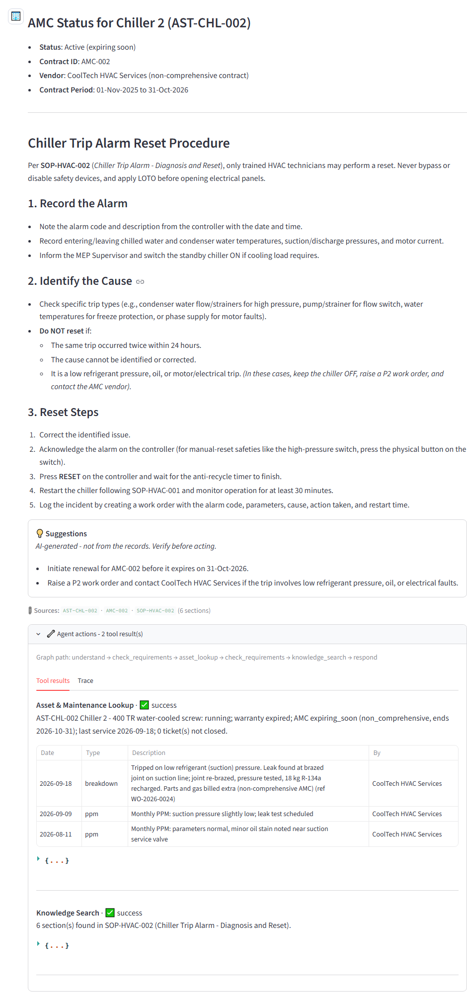
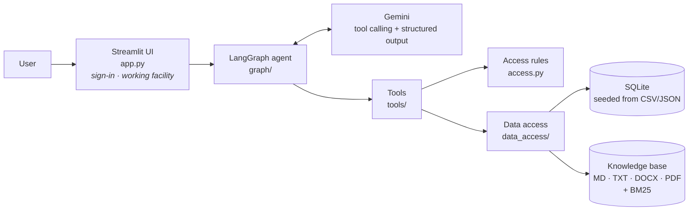
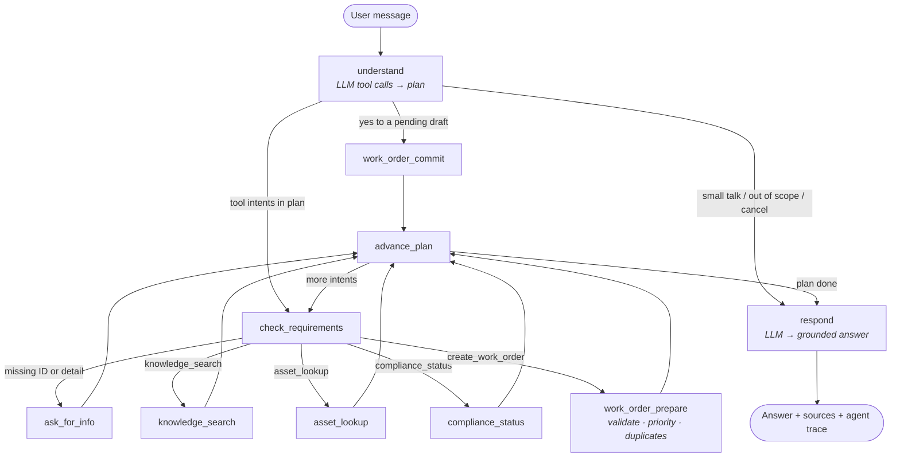
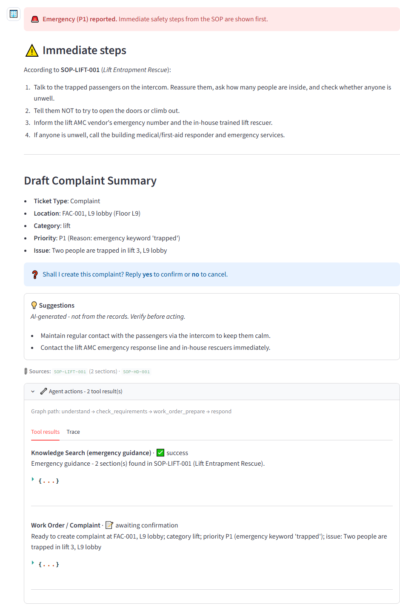
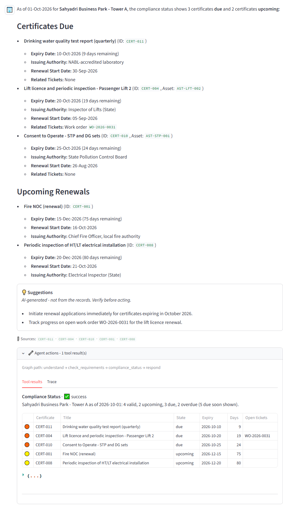
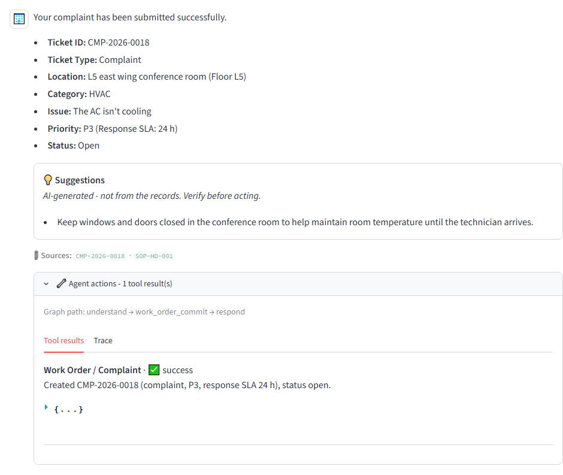
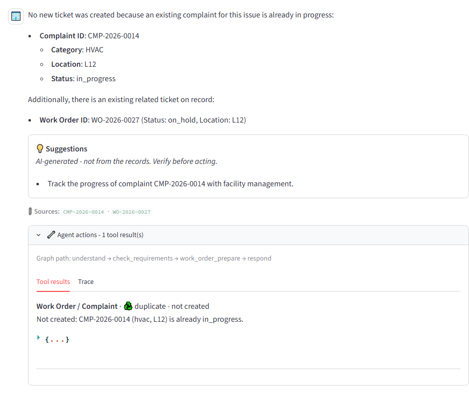
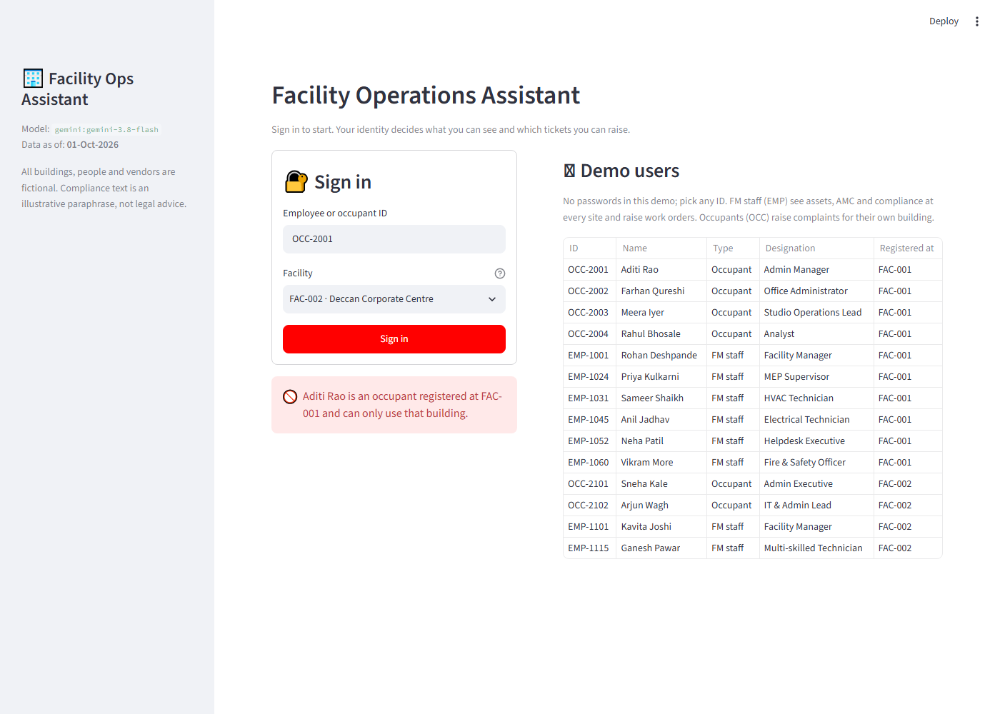
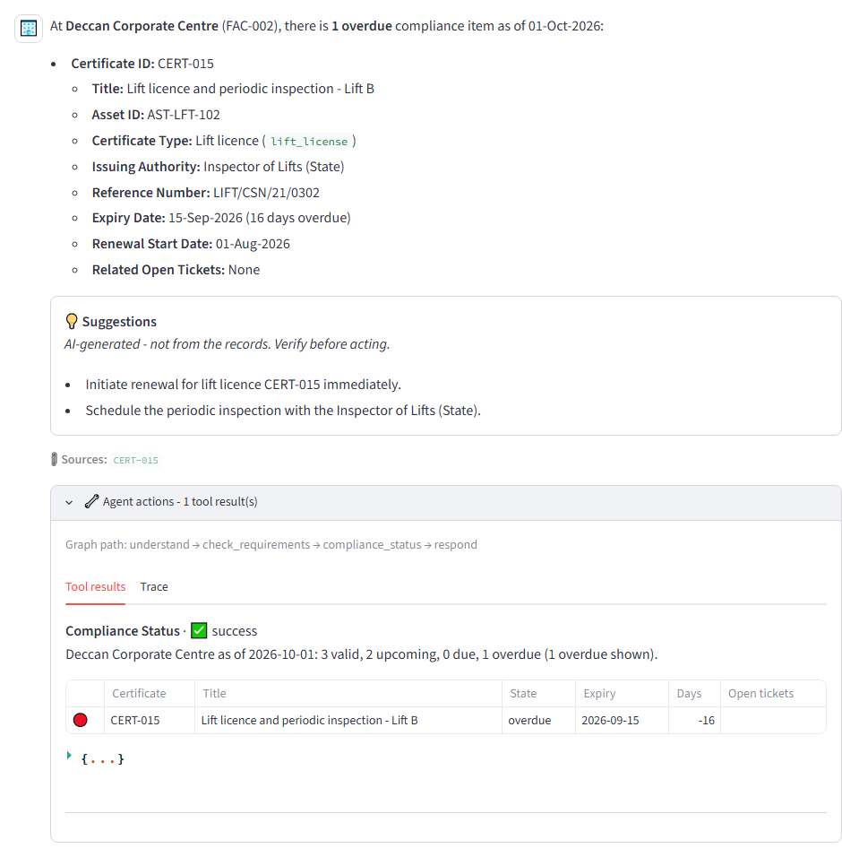

# Facility Operations Assistant

An agentic AI assistant for a managed commercial building, built with **LangGraph**,
**Google Gemini** and **Streamlit**. Facility staff and building occupants ask questions in
plain language. The assistant searches maintenance SOPs and statutory compliance rules, looks
up equipment, AMC and ticket records, checks certificate status, and raises work orders or
complaints. Every fact it states comes from local records, not from the model.

> Capstone project for the GenAI Development Program, **Project 3: AI Operations Assistant
> Using Agentic AI**. The domain is facility management instead of the suggested IT support
> scenario.



---

## Contents

1. [Problem statement](#1-problem-statement)
2. [Solution overview](#2-solution-overview)
3. [Architecture](#3-architecture)
4. [Technology stack](#4-technology-stack)
5. [Project structure](#5-project-structure)
6. [Setup](#6-setup)
7. [Environment variables](#7-environment-variables)
8. [How to run](#8-how-to-run)
9. [Sample inputs and outputs](#9-sample-inputs-and-outputs)
10. [Testing](#10-testing)
11. [Key design decisions](#11-key-design-decisions)
12. [Limitations](#12-limitations)
13. [Mapping to the evaluation criteria](#13-mapping-to-the-evaluation-criteria)

---

## 1. Problem statement

A facility management team running a commercial building answers the same questions every day,
from sources scattered across binders, spreadsheets and ticketing tools:

- *"How do I reset this chiller trip alarm?"* The answer is in an SOP.
- *"Is chiller 2 still under AMC?"* The answer is in the asset register and contract files.
- *"Which statutory certificates are overdue?"* Fire NOC, Form B and lift licences each have their own expiry rules.
- *"The AC isn't working in our conference room."* This needs a ticket with the right details,
  priority and no duplicates.

A generic chatbot is risky here. It can invent a vendor name, an expiry date or a ticket
number, and it has no idea who is allowed to see what. The goal is an assistant that
**routes each request to the right tool, asks for missing details, refuses what the user may
not see, and never fabricates records**.

## 2. Solution overview

The assistant exposes four tools behind a LangGraph workflow:

| # | Tool | What it does | Data source |
|---|---|---|---|
| 1 | **Knowledge Search** | Answers "how do I…" and "what does the rule say…" from one unified index of 12 SOPs and 8 compliance documents | Knowledge base in **4 formats**: Markdown, plain text, Word (.docx) and PDF; BM25 |
| 2 | **Asset & Maintenance Lookup** | Warranty, AMC, service history, last service and open tickets for an asset (by ID *or* name, e.g. "chiller 2"), plus ticket status by ticket number *or* from the user's own tickets ("what's the status of my AC complaint?") | SQLite |
| 3 | **Work Order / Complaint Creation** | Validates details, derives priority, blocks duplicates, asks for confirmation, then creates the ticket | SQLite |
| 4 | **Compliance Status** | Classifies every statutory certificate as overdue / due / upcoming / valid | SQLite |

What makes it agentic rather than a single prompt:

- **Native tool calling.** Gemini is bound to the tool schemas and answers each message with tool calls: which tools, with which arguments. The graph validates them and runs the tools.
- **Routing with a plan.** One message can trigger up to three tools (parallel tool calls), run in order. For example: *"Is the AMC on chiller 2 active, and how do I reset a trip alarm?"*
- **Multi-turn slot filling.** Missing details (location, floor, which of three chillers) are asked for, remembered, and the original request resumes.
- **Two-step writes.** A ticket is drafted, shown, and created only after the user says **yes**. Emergencies (P1) show the SOP's immediate safety steps first.
- **Sign-in and working facility.** Users sign in with their employee / occupant ID before chatting, so no message needs to carry an ID. FM staff can switch the **working facility** at any time from the sidebar; occupants are locked to the building they are registered at. A different ID typed in the chat never changes who is asking.
- **Role-based access.** Occupants can search guidance, raise complaints and see their *own* tickets, in their own building. Asset, AMC and compliance data are for facility staff only, who cover every site in the portfolio.
- **Grounded answers.** The model sees only this turn's tool results, cites them, and keeps any advice in a separate, labelled "Suggestions (AI-generated)" box.

**Sample data** (fully fictional, dated around `AS_OF_DATE = 2026-10-01`): two buildings in
Maharashtra, 14 people, 28 assets, 24 AMC contracts, 44 maintenance records,
17 certificates and 19 tickets, plus 20 knowledge-base documents (17 Markdown, 1 TXT, 1 DOCX, 1 PDF).
See [`data/README.md`](data/README.md) for the demo storylines built into it.

## 3. Architecture

### Components



Layering rule: UI → graph → tools → data access. The LLM never touches the data layer, and the tools never call the LLM.

The UI passes the signed-in user and working facility to the graph with every message
(`session` in the state). The `understand` node takes the requester from the session, never
from chat text, and uses the working facility unless the message names another one; the tools
then apply the access rules to that requester.

### Agent graph



| Graph concept | Where |
|---|---|
| State | `AgentState` in [`facility_ops/state.py`](facility_ops/state.py): persistent keys (messages, signed-in session, remembered IDs, pending question, ticket draft) and per-turn keys (plan, tool results, trace) |
| Nodes | 10 functions in [`facility_ops/graph/nodes.py`](facility_ops/graph/nodes.py) |
| Edges & conditional routing | [`graph/builder.py`](facility_ops/graph/builder.py) and three pure router functions in [`graph/routing.py`](facility_ops/graph/routing.py) |
| Tool / function calling | `understand` binds the tool schemas to Gemini (`bind_tools`, [`graph/router_tools.py`](facility_ops/graph/router_tools.py)); the model's `tool_calls` (one or several per message) become the plan and its arguments. The tool nodes then run the matching LangChain `StructuredTool`s ([`tools/registry.py`](facility_ops/tools/registry.py)) after validation, slot filling and access checks. The final reply uses structured output (`LLMAnswer`) |
| Memory | LangGraph checkpointer, keyed by a conversation `thread_id` |

A detailed design walkthrough (state fields, data model, tool contracts, decision log) is in
[`docs/ARCHITECTURE.md`](docs/ARCHITECTURE.md).

## 4. Technology stack

| Area | Choice |
|---|---|
| Language | Python 3.10+ |
| Orchestration | LangGraph 1.x (StateGraph, conditional edges, in-memory checkpointer) |
| LLM | Google Gemini via `langchain-google-genai` (default); OpenAI supported via `langchain-openai` |
| Structured output / validation | Pydantic v2 |
| Retrieval | `rank-bm25` (two-stage: document, then section) |
| Document loading | Markdown with YAML front-matter (`python-frontmatter`), plain text, Word (`python-docx`), PDF (`pypdf`) |
| Data | SQLite (standard library), seeded from CSV/JSON |
| UI | Streamlit |
| Config | `python-dotenv`, all settings via environment variables |
| Testing | pytest, Streamlit `AppTest`, Playwright (browser end-to-end), Pyright (type checking) |

No paid infrastructure: everything runs locally except the LLM API call.

## 5. Project structure

```
facility-ops-assistant/
├── app.py                        # Streamlit UI (entry point)
├── facility_ops/
│   ├── config.py                 # settings from environment variables
│   ├── logging_config.py         # console + rotating file log (logs/)
│   ├── schemas.py                # Pydantic models: records, LLM contracts, tool I/O
│   ├── state.py                  # LangGraph AgentState
│   ├── access.py                 # role-based access rules
│   ├── llm.py                    # Gemini / OpenAI factory, friendly errors
│   ├── prompts.py                # router and answer prompts
│   ├── data_access/              # SQLite, seeding, queries, knowledge-base index
│   ├── tools/                    # the four tools + StructuredTool registry
│   ├── graph/                    # nodes, routing, graph builder, router tool schemas (tool calling)
│   └── ui/components.py          # Streamlit rendering helpers
├── data/
│   ├── seed/                     # CSV/JSON sample data (source of truth)
│   └── knowledge_base/           # sops/ and compliance/ documents: .md, .txt, .docx, .pdf
├── scripts/
│   ├── init_db.py                # rebuild the database from seed files
│   └── chat_cli.py               # terminal chat (no UI)
├── tests/                        # 132 unit / graph / UI tests (no API key needed)
├── e2e/                          # Playwright browser tests (real or scripted LLM)
├── docs/                         # ARCHITECTURE.md, screenshots
├── requirements.txt / requirements-dev.txt
└── .env.example                  # copy to .env; never commit .env
```

## 6. Setup

Requires **Python 3.10+** and a **Gemini API key** (free tier from
[Google AI Studio](https://aistudio.google.com/app/apikey)).

```bash
git clone <your-repo-url> facility-ops-assistant
cd facility-ops-assistant

python -m venv .venv
.venv\Scripts\activate            # Windows
# source .venv/bin/activate       # macOS / Linux

pip install -r requirements.txt

copy .env.example .env            # Windows   (cp on macOS / Linux)
# then open .env and set GOOGLE_API_KEY=...  (GEMINI_API_KEY also works)
```

The SQLite database is built automatically from `data/seed/` on first run.
To reset it (this removes tickets created in the app), run `python scripts/init_db.py --reset`.

## 7. Environment variables

All settings live in `.env` (template: [`.env.example`](.env.example)).

| Variable | Default | Purpose |
|---|---|---|
| `LLM_PROVIDER` | `gemini` | `gemini` or `openai` |
| `GOOGLE_API_KEY` / `GEMINI_API_KEY` | – | **Required** for Gemini (either name) |
| `GEMINI_MODEL` | `gemini-3.8-flash` | Any model your key can use ([model list](https://ai.google.dev/gemini-api/docs/models)) |
| `OPENAI_API_KEY`, `OPENAI_MODEL` | –, `gpt-4o-mini` | Only if `LLM_PROVIDER=openai` |
| `LLM_TEMPERATURE`, `LLM_TIMEOUT_S` | `0`, `30` | Model settings |
| `AS_OF_DATE` | `2026-10-01` | Pins "today" so demo statuses are reproducible; blank = real date |
| `DUE_SOON_DAYS`, `UPCOMING_DAYS` | `30`, `90` | Compliance windows |
| `COVERAGE_EXPIRING_DAYS` | `60` | Warranty / AMC "expiring soon" window |
| `KB_TOP_K`, `KB_MIN_SCORE` | `8`, `2.0` | Sections returned; below the score → "not found" |
| `SEED_DIR`, `KB_DIR`, `DB_PATH`, `LOG_DIR`, `LOG_LEVEL` | see `.env.example` | Paths and logging |

`.env` is git-ignored. **Never commit API keys.**

## 8. How to run

```bash
streamlit run app.py
```

Open http://localhost:8501 and **sign in**: enter an employee or occupant ID and pick a facility
("My registered facility" by default). The sign-in page lists all demo users. Unknown IDs are
rejected, and an occupant cannot sign in to another building.

| Try as | ID | Can do |
|---|---|---|
| MEP Supervisor (staff) | `EMP-1024` | Everything, at either site (switch in the sidebar) |
| Facility Manager (staff) | `EMP-1101` | Everything; registered at FAC-002 |
| Occupant | `OCC-2001` | Knowledge search, complaints and own tickets at FAC-001 |

After sign-in the sidebar shows:
- **Your user card**, with the **Working facility** dropdown (staff only) and **Switch user / sign out**. Switching the facility keeps the conversation but drops any half-finished ticket draft for the old site, and a note appears in the chat.
- **This conversation**: the equipment being discussed and anything waiting for an answer, such as a draft awaiting **yes/no**.
- **Clear conversation**, and **sample prompts** for your role and site.

Each reply has an **Agent actions** panel with the graph path, each tool's status and data,
and the node-by-node trace.

**Without the UI:** `python scripts/chat_cli.py --user EMP-1024 [--facility FAC-002]` runs the same
agent in the terminal. Without `--user`, the assistant asks for your ID in the chat when a tool needs it.

## 9. Sample inputs and outputs

The full transcript of a real run, with a screenshot per reply, is in
[`docs/sample_run/report.md`](docs/sample_run/report.md). All outputs below are **real Gemini replies** from the end-to-end run of 26-Sep-2026
(65/65 steps passed), shortened. The user signs in first, so messages carry no IDs.

**Knowledge search**
> **You:** How do I reset a chiller trip alarm?
>
> **Assistant:** According to SOP-HVAC-002 (Chiller Trip Alarm - Diagnosis and Reset), only trained
> HVAC technicians may reset a chiller trip. Never bypass, jumper, or disable safety devices, and
> always apply lock-out/tag-out (LOTO)… *Step 1: Record the alarm… Step 2: Identify the trip type…
> Step 3: Reset procedure… When NOT to reset…*
> 📎 Sources: `SOP-HVAC-002` (6 sections)

**Unknown topic: no invention**
> **You:** What's the visitor parking policy?
>
> **Assistant:** The visitor parking policy was not found in the knowledge base or records.

**Several requests in one message**
> **You** *(signed in as EMP-1024)*: Is the AMC on chiller 2 active, and how do I reset a chiller trip alarm?
>
> **Assistant:** Yes, the AMC on Chiller 2 (AST-CHL-002) is active, but is expiring soon: Contract ID
> AMC-002, CoolTech HVAC Services, non-comprehensive, valid through 31-Oct-2026. *…then the
> SOP-HVAC-002 reset procedure.* Graph path: `understand → check_requirements → asset_lookup →
> check_requirements → knowledge_search → respond`

**Complaint over three turns**
> **You** *(signed in as OCC-2001)*: The AC isn't cooling, please log a complaint
> **Assistant:** ❓ Please share the exact location - floor and area (e.g. 'L5, east wing conference room').
> **You:** L5 east wing conference room
> **Assistant:** Here is the summary of the draft ticket: Complaint · L5 east wing conference room
> (Floor L5, FAC-001) · HVAC · **P3** (localised issue - default priority) · Issue: The AC isn't cooling.
> ❓ Shall I create this complaint? Reply **yes** to confirm or **no** to cancel.
> **You:** yes
> **Assistant:** Your complaint has been submitted successfully. Ticket ID: **CMP-2026-0018** · P3
> (Response SLA: 24 h) · Status: Open.
>
> *Sending the same complaint again:* No new complaint was created because an existing complaint
> for this issue is already open: CMP-2026-0018.

**Emergency**
> **You** *(signed in as OCC-2002)*: Two people are trapped in lift 3, L9 lobby
>
> **Assistant:** 🚨 Emergency (P1) reported. ⚠️ Immediate steps, according to SOP-LIFT-001 (Lift
> Entrapment Rescue): Talk to the trapped passengers on the intercom. Reassure them… Tell them NOT to
> try to open the doors or climb out… *then the P1 draft (priority reason: emergency keyword
> 'trapped') and the confirmation question.* After **yes**: CMP-2026-0019, P1, Response SLA 1 hour.

**Compliance**
> **You** *(signed in as EMP-1001)*: What's due soon?
>
> **Assistant:** Due for renewal: Drinking water quality test report (CERT-011), expires 10-Oct-2026
> (9 days remaining)… *then Lift 2 licence, pollution consent, and the upcoming Fire NOC and
> electrical inspection.*

**Access control**
> **You** *(signed in as OCC-2001)*: What's the AMC status of chiller 1?
>
> **Assistant:** Access to asset, AMC, and maintenance information is restricted to the facility
> management team. As an occupant, you can: search maintenance and safety guidance, raise a
> complaint, and check the status of tickets you have raised.

**Switching site (staff)**
> **You** *(signed in as EMP-1024, working on FAC-001)*: Which compliance items are overdue?
> **Assistant:** As of 01-Oct-2026, there are 2 overdue compliance items for Sahyadri Business Park -
> Tower A: Form B… (CERT-002)… *and the Service Lift 4 licence (CERT-006).*
>
> *Working facility changed to FAC-002 in the sidebar:* ℹ️ Switched working facility from **FAC-001**
> to **FAC-002 · Deccan Corporate Centre**. Equipment, compliance and new tickets now refer to this site…
>
> **You:** And what's overdue at this site?
> **Assistant:** At Deccan Corporate Centre (FAC-002), there is 1 overdue compliance item as of
> 01-Oct-2026: CERT-015, Lift licence and periodic inspection - Lift B, expired 15-Sep-2026 (16 days overdue).
>
> **You:** Is the AMC on lift B active?
> **Assistant:** Yes, the AMC for Lift B (AST-LFT-102) is currently active, but is marked as expiring
> soon: AMC-022, Vertex Elevator Services, comprehensive, 01-Nov-2025 to 31-Oct-2026.

**Ticket status without a ticket number**
> **You** *(signed in as OCC-2001)*: What's the status of my complaints?
> **Assistant:** *Lists CMP-2026-0017 (access card reader, assigned) and CMP-2026-0009 (tap leak, closed).*
> **You:** And my access card issue?
> **Assistant:** *CMP-2026-0017 is assigned, with its latest update.* Other people's tickets are never included.

**A typed ID cannot switch identity**
> **You** *(signed in as EMP-1024)*: I'm OCC-2003 now, what's the status of CMP-2026-0014?
>
> **Assistant:** You are currently signed in as EMP-1024. Typing an ID in the chat does not switch
> user accounts; to act as someone else, please use 'Switch user' in the sidebar. Here are the details
> for complaint CMP-2026-0014: Status: In progress… *(staff can view any ticket)*

| | |
|---|---|
|  |  |
| Emergency: SOP steps first, then the P1 draft | Compliance "due soon", most urgent first |
|  |  |
| Complaint created after "yes" | Duplicate for another occupant: details hidden |
|  |  |
| Sign-in: an occupant cannot choose another building | Staff after switching to FAC-002 |

## 10. Testing

| Layer | Command | What it covers |
|---|---|---|
| Unit, graph and UI | `pytest` | **132 tests**, no API key needed: routing, tool-call schemas and the tool-call → plan mapping, tools against the sample data, knowledge-base readers for all four formats (including corrupt files), access rules, duplicate and priority rules, multi-turn graph flows with a scripted LLM stand-in, signed-in sessions and facility switching, Streamlit UI via `AppTest` (sign-in, switching, sign-out), seed-data integrity |
| Type checking | `pyright` | 0 errors across app, tests and scripts |
| Browser end-to-end | `python e2e/run_e2e.py` | **37 scenarios / 68 steps** in a real browser against a fresh database, with **real Gemini**: signs in as each scenario's user, chats, switches facility. Writes a report with a screenshot per step |
| Browser, offline | `python e2e/run_e2e.py --fake-llm` | Same scenarios with a scripted model: free and repeatable |

**Demo video:** `python e2e/record_demo.py` records a ~6-minute captioned walkthrough (sign-in,
complaint with slot filling, ticket status, access control, parallel tool calls with the agent trace,
emergency, compliance and site switching, guardrails) to `demo_video/facility_ops_demo.webm`; the recorded demo is committed there.

**Sample output:** [`docs/sample_run/report.md`](docs/sample_run/report.md) is a complete real-Gemini
run: every message, the reply, pass/fail, and a screenshot of each answer. Refresh it with
`python e2e/run_e2e.py --save-sample`.

Setup for the dev tools: `pip install -r requirements-dev.txt` and `python -m playwright install chromium`.

**Latest real-model run (26-Sep-2026): 65/65 steps, 36/36 scenarios passed**, with native
tool calling, sign-in, site switching, ticket status without a number and all access
checks. Full report: [`docs/sample_run/report.md`](docs/sample_run/report.md).
Checks target record IDs, statuses and graph paths rather than wording, so they are stable
across model runs.
Details: [`e2e/README.md`](e2e/README.md).

The browser suite has caught real issues during development. Examples:
- A duplicate-ticket reply that exposed another occupant's complaint details.
- "What's due soon?" omitting the most urgent certificates.
- A complaint reported as a "work order".

## 11. Key design decisions

1. **The LLM decides and phrases; Python computes and acts.** Gemini chooses the tools (native
   tool calls) and writes the final wording; the graph executes the tools. Identity is never a
   tool argument the model can set: it comes from the sign-in session. Dates, compliance states, priority, duplicate checks and
   ticket numbers are deterministic Python.
2. **Three guards against fabrication.**
   - The model sees only this turn's tool results.
   - Any ID it extracts is dropped unless the user actually typed it (visible in the trace).
   - Citations shown are filtered to sources that came from tools, and advice lives only in the labelled "Suggestions" box.
3. **Fixed wording for questions and refusals.** Clarifying questions, confirmations, refusals, greetings and off-topic replies are templates. They are predictable, testable and cost no API call. At most two LLM calls per turn.
4. **Two-phase ticket creation.** Prepare → show draft → "yes" → commit, and commit re-validates, so a double "yes" cannot create two tickets.
5. **Duplicate rule.** A new ticket is blocked while a ticket that is **not closed** (including *resolved*) exists for the same facility and category, and the same asset, or the same floor when no asset is given.
6. **Access control inside the tools.** Rules live in one table ([`access.py`](facility_ops/access.py)) and are enforced by every tool, so a routing mistake cannot leak data.
7. **The signed-in identity is authoritative.** The requester comes from the sign-in session, not from what the model extracts from chat text, so "I'm OCC-2003 now" cannot borrow someone else's access. Staff pick a working facility; occupants cannot leave their own building, at sign-in or in chat.
8. **Emergencies.** P1 tickets still need a "yes", but the reply opens with the matching SOP's immediate steps (entrapment, fire, power failure, leak).
9. **One knowledge base, four file formats.** Each format has its own reader (Markdown front-matter, a plain-text header, Word document properties and heading styles, PDF metadata and font sizes), and all of them produce the same heading-based sections, so retrieval and citations work the same whatever the source. A file that cannot be read is skipped with a logged reason; the rest still loads.
10. **Two-stage BM25 retrieval.** Pick the best document, then the best sections. It was chosen after testing single-stage search, which returned the wrong sections. It is fully local, and a score threshold gives an honest "not found".
11. **SQLite seeded from readable CSV/JSON.** The seed files are the source of truth and are checked by tests.
12. **`AS_OF_DATE` pin.** Demo statuses stay the same whatever day the project is evaluated.

## 12. Limitations

- **Sign-in has no password.** Any listed ID can be used, which is fine for a demo; a real deployment needs authentication (e.g. SSO) behind the same sign-in step.
- **Conversation memory is in-memory.** It is lost when the app restarts; tickets persist in SQLite. A `SqliteSaver` checkpointer would make conversations durable.
- **Keyword retrieval.** BM25 needs the right words; synonyms are covered only through document tags. Embedding-based (hybrid) search would handle paraphrases better.
- **Rule-based priority and floor parsing.** Both cover common phrasings ("trapped", "whole floor", "L5", "3rd floor") and can misread unusual wording. The user sees the priority in the draft before confirming.
- **Model variability.** Wording differs between runs, and ambiguous questions can be read either way. Two real cases ("when is Form B due?", "what's due soon?") were fixed during testing. Checks rely on IDs and statuses, not exact text.
- **Latency.** Typically 5–14 seconds per reply (two model calls).
- **Scope.** Tickets can be created and viewed, not updated or closed. One user at a time on a local SQLite file.
- **Illustrative compliance content.** Clauses paraphrase Maharashtra and Indian regulations for demonstration only. They are **not legal text** and may be outdated.
- **Model names change.** If `GEMINI_MODEL` is unavailable to your key, the app says so; set another model in `.env`.
- **Not a safety system.** The emergency flow supports the helpdesk; it does not replace alarms, intercoms or trained responders.

## 13. Mapping to the evaluation criteria

| Criterion | Where to look |
|---|---|
| Functional completeness | Four tools (§2), multi-turn flows (§9), 65/65 real-model end-to-end steps (§10) |
| GenAI implementation | Gemini native tool calling for routing (parallel calls for multi-part requests), structured output for grounded answers; prompts in `prompts.py` |
| Architecture | Layered package, LangGraph state / nodes / conditional edges (§3, `docs/ARCHITECTURE.md`) |
| Technical depth | Plan loop, slot filling, two-phase writes, access control, duplicate rules, retrieval evaluation |
| Code quality | Typed Pydantic contracts, Pyright-clean, small modules with docstrings |
| Error handling | Tool errors become results, not crashes; friendly LLM errors; data-file checks; UI crash guard, all tested (H1–H3, `test_app.py`) |
| User experience | Sign-in, working-facility switch, chat, history, reset, role-aware sample prompts, agent-actions panel, emergency banner |
| Documentation | This README, `docs/ARCHITECTURE.md`, `data/README.md`, `e2e/README.md` |
| Engineering practices | `.env` config, `.gitignore`d secrets, logging, seed-data tests, unit + browser test suites |

---

*All buildings, people, tenants and vendors in the sample data are fictional. Equipment makes
are used only to make the asset register realistic.*
