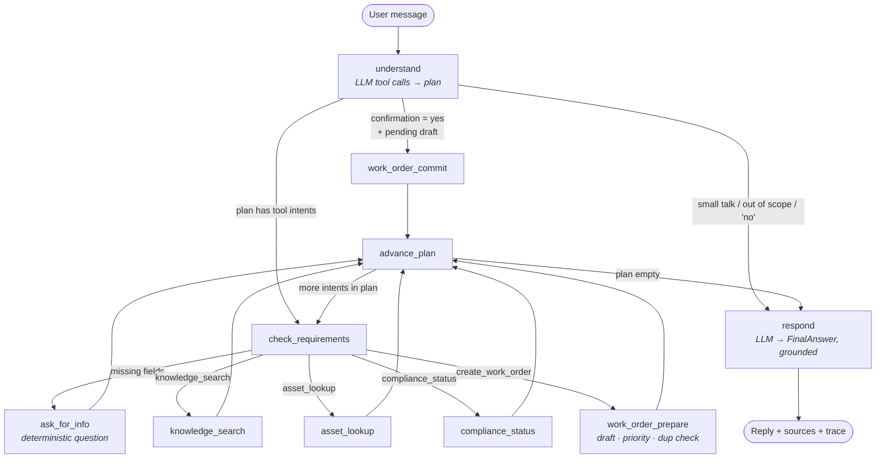
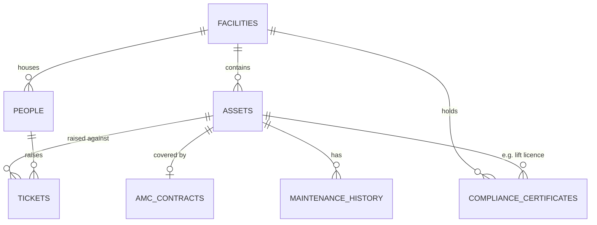

# Facility Operations Assistant — Architecture

> Status: **complete.** All four tools, access control, the LangGraph agent and the Streamlit UI are
> implemented. 83 unit/graph/UI tests pass, Pyright reports 0 errors, and the browser end-to-end
> suite passes 56/56 steps with real Gemini. Setup, samples and limitations are in the
> [README](../README.md); this document covers the design in depth.

## 1. Folder structure

```
facility-ops-assistant/
├── app.py                          # Streamlit entry point (thin)
├── requirements.txt
├── .env.example                    # template; real .env is git-ignored
├── .gitignore
├── README.md
├── facility_ops/                   # the application package
│   ├── config.py                   # all settings from env vars (paths, thresholds, models)
│   ├── access.py                   # role-based access rules (occupant vs FM staff)
│   ├── logging_config.py           # console + rotating file log
│   ├── schemas.py                  # Pydantic: domain records, LLM contracts, tool I/O
│   ├── state.py                    # LangGraph AgentState + session models
│   ├── llm.py                      # OpenAI / Gemini chat-model factory
│   ├── prompts.py                  # system prompts
│   ├── data_access/                # ONLY layer that touches files / SQLite
│   │   ├── db.py                   # connection, schema creation, first-run seeding
│   │   ├── repositories.py         # typed queries -> schemas.* models
│   │   └── knowledge_base.py       # .md/.txt/.docx/.pdf readers, section chunker, BM25 index
│   ├── tools/                      # the 4 tools (pure functions, typed I/O)
│   │   ├── common.py               # error wrapper, identity check, coverage dates
│   │   ├── knowledge_search.py
│   │   ├── asset_lookup.py
│   │   ├── work_order.py
│   │   ├── compliance_status.py
│   │   └── registry.py             # exposes them as LangChain StructuredTools
│   ├── graph/                      # LangGraph orchestration
│   │   ├── nodes.py                # node functions
│   │   ├── routing.py              # conditional-edge functions (pure, tested)
│   │   ├── router_tools.py         # tool schemas bound to the model + tool-call mapping
│   │   └── builder.py              # StateGraph assembly + checkpointer
│   └── ui/
│       └── components.py           # Streamlit rendering helpers
├── data/
│   ├── seed/                       # human-readable CSV/JSON seed data
│   ├── knowledge_base/
│   │   ├── sops/                   # maintenance SOPs (.md with front-matter)
│   │   └── compliance/             # statutory clauses (.md with front-matter)
│   └── facility_ops.db             # generated on first run (git-ignored)
├── scripts/init_db.py              # rebuild DB from seed (--reset)
├── tests/                          # pytest: routing, tools, validation
├── docs/ARCHITECTURE.md            # this file
└── logs/                           # runtime logs (git-ignored)
```

Layering rule: `app.py → graph → tools → data_access`. Nothing skips a layer.
The UI never queries data directly, and tools never call the LLM.

## 2. Graph



**What each part covers from the program spec:**

| Requirement | Where |
|---|---|
| State | `AgentState` in `state.py` |
| Nodes | 10 nodes in `graph/nodes.py` |
| Edges + conditional routing | `graph/builder.py` and `graph/routing.py` |
| Tool / function calling | `understand` binds the router tool schemas (`graph/router_tools.py`) with `bind_tools(tool_choice="any")`; the model's `tool_calls` become the plan. Tool nodes run the registry StructuredTools (Pydantic `args_schema`) |
| Multi-step workflow | `plan` loop: one message can trigger up to 3 tools in sequence |
| Memory across turns | checkpointer keyed by `thread_id`, plus `slots` and `awaiting` |
| Validation before acting | `check_requirements` + two-phase work order (prepare → confirm → commit) |
| Final response generation | `respond` |

## 3. State (`facility_ops/state.py`)

| Key | Lifetime | Type | Purpose |
|---|---|---|---|
| `messages` | persistent | `list[AnyMessage]` (add_messages) | Chat transcript |
| `slots` | persistent | `ConversationSlots` | Known requester_id, facility_id, asset_id, asset_hint, ticket_id |
| `awaiting` | persistent | `AwaitingInput \| None` | What we asked last turn, and which intent to resume |
| `pending_work_order` | persistent | `WorkOrderDraft \| None` | Ticket being assembled across turns |
| `session` | persistent (refreshed each turn) | `SessionContext \| None` | Signed-in `requester_id` + working `facility_id`, passed in by the UI with every message. Authoritative when present; `None` in the CLI without `--user` and in older tests |
| `decision` | per-turn | `IntentDecision` | The model's tool calls merged into intents + entities (the raw calls are shown in the trace) |
| `plan` | per-turn | `list[Intent]` | Remaining tool intents, in order |
| `current_intent` | per-turn | `Intent` | Intent being processed |
| `missing_fields` | per-turn | `list[str]` | Output of `check_requirements` |
| `tool_results` | per-turn | `list[ToolResult]` | **The only source of facts for `respond`** |
| `trace` | per-turn | `list[TraceStep]` | Node-by-node log for the UI |
| `final_answer` | per-turn | `FinalAnswer` | Structured reply for the UI |
| `error` | per-turn | `str \| None` | Fatal error shown as a banner |

The "Clear conversation" button starts a new `thread_id`, which gives a clean state.
"Switch user / sign out" does the same and returns to the sign-in screen.

**Session handling in `understand`.** With a session, `slots.requester_id` is always
the signed-in user and `slots.facility_id` is the working facility (or a facility the
message names explicitly). A different person ID extracted from the message is
discarded, and a `NOT_PERMITTED` notice tells the user to use "Switch user". When a
staff member changes the working facility, the UI calls `graph.update_state` to
clear the asset/ticket context, any pending question and any half-finished draft,
and it adds a note to the transcript, so the conversation continues at the new site.

## 4. Data model (SQLite, seeded from `data/seed/`)



**ID formats** (regex in `schemas.ID_PATTERNS`, used to catch invented IDs):
`FAC-001` · `EMP-1024` (FM staff) / `OCC-2001` (occupant) · `AST-CHL-001` ·
`WO-2026-0042` / `CMP-2026-0017` · `CERT-004`

**Knowledge base:** 12 SOPs + 8 compliance docs in four formats, each with its own
reader that returns metadata (`doc_id`, `doc_type`, `title`, `tags`) and heading-based
sections:

| Format | Metadata from | Sections from | Sample |
|---|---|---|---|
| `.md` | YAML front-matter | `## ` headings | 17 documents |
| `.txt` | optional `Title:` / `Tags:` / `Doc-Type:` header | `## ` or ALL-CAPS heading lines | SOP-SEC-001 |
| `.docx` | Word document properties (title, keywords, category, subject) | Heading 2 paragraphs; bullets and tables kept | SOP-HK-001 |
| `.pdf` | PDF metadata (title, keywords, subject) | lines in a larger or bold font; one section per page if none | REG-FIRE-003 |

Missing metadata falls back to the file name (`SOP-SEC-001_...` → doc ID) and the folder
(`sops/`, `compliance/` → doc type). Unreadable files (corrupt, missing reader library,
duplicate doc ID, Office lock files) are skipped with a logged reason; the rest loads.
SOPs and compliance clauses share **one index**, and `doc_type` is only metadata for
citation labels. Retrieval is **two-stage BM25**: rank documents on title + tags +
full text, then rank sections within the winning document(s). Prototyping showed
single-stage section-level BM25 mis-ordered sections, while two-stage ranking put the
correct document first on 11/11 demo questions. Relevant queries score ≥ 4.4 and
off-topic ones ≤ 0.5, so `KB_MIN_SCORE=2.0` gives an honest "not found".

See `data/README.md` for the dataset and the demo storylines built into it.

## 5. Tool contracts (`facility_ops/schemas.py`)

| Tool | Input | Output | Non-success statuses |
|---|---|---|---|
| 1 Knowledge Search | `KnowledgeSearchInput(query, top_k, doc_type)` | `KnowledgeSearchOutput(hits[chunk, score])` | NOT_FOUND if best score < `KB_MIN_SCORE` |
| 2 Asset & Maintenance Lookup | `AssetLookupInput(asset_id \| asset_hint+facility_id \| ticket_id \| my_tickets+keyword/issue_category)` | asset, warranty_state, AMC + amc_state, last_service, history, open_tickets, candidates, or the requester's own tickets | NOT_FOUND, NEEDS_INPUT (ambiguous hint) |
| 3 Work Order Creation | `WorkOrderDraft` | `WorkOrderOutput(draft, created, duplicates)` | NEEDS_INPUT, DUPLICATE, NEEDS_CONFIRMATION |
| 4 Compliance Status | `ComplianceStatusInput(facility_id, status_filter, cert_type)` | items[cert, state, days_to_expiry, renewal_should_start_on], counts | NOT_FOUND |

Every tool returns a uniform **`ToolResult`** (tool, status, deterministic
summary, data, citations, follow_up_question, error). The `@safe_tool` decorator
turns any exception (missing data file, DB error, bad input) into
`status=ERROR` with a friendly summary, and the details go to the log.
A failing tool never crashes the turn. Statuses: SUCCESS, NOT_FOUND,
NEEDS_INPUT, NEEDS_CONFIRMATION, DUPLICATE, NOT_PERMITTED, ERROR.

The same functions are exposed as LangChain `StructuredTool`s in
`tools/registry.py` (name, description, Pydantic `args_schema`).

**Required fields.** `check_requirements` enforces these before any tool runs:

| Intent | Required |
|---|---|
| knowledge_search | a query (rewritten standalone by the LLM, raw message as fallback) |
| asset_lookup | `requester_id`, plus `asset_id` or `asset_hint` or `ticket_id` |
| compliance_status | `requester_id` (facility = working facility, else the requester's profile) |
| create_work_order | `requester_id`, `facility_id`, `location`, `issue_description`, `issue_category` |

## 6. Walk-throughs

**A. Multi-turn slot filling + confirmation (work order)**

| Turn | User | Path | Result |
|---|---|---|---|
| 1 | *(signed in as OCC-2001)* "The AC isn't cooling, please log a complaint" | understand → check_requirements → work_order_prepare → advance_plan → respond | Draft started (description, category=hvac); requester and facility come from the session. Missing `location` → "Please share the exact location - floor and area…" |
| 2 | "L5 east wing conference room" | understand (resumes `awaiting.intent`) → check_requirements → work_order_prepare → advance_plan → respond | Floor parsed as L5. Priority P3 by rule. No duplicates. Shows draft card: "Shall I create this complaint? (yes/no)" |
| 3 | "yes" | understand → **work_order_commit** → advance_plan → respond | `CMP-2026-0018` created. The reply shows the stored record |

**B. Multi-intent in one message**

"Is the AMC on AST-CHL-001 still active, and how do I reset a chiller trip alarm?"
→ plan = [asset_lookup, knowledge_search] → both tools run through the `advance_plan` loop.
The reply has two grounded sections: AMC facts cite `AMC-…`, the procedure cites `SOP-HVAC-002 § Trip reset`.

**C. Duplicate prevention**

"Lift 2 is stopping at L7" while `WO-2026-0031` (in progress) exists for AST-LFT-002
→ work_order_prepare returns DUPLICATE with the existing ticket. Nothing is created,
and the user is told the existing ticket ID and status.

**Duplicate rule (decided):** a new ticket is blocked when a ticket that is **not
`closed`** exists for the same facility + category, and either the same `asset_id`
or (when no asset is given) the same normalised floor (`L5`, `B2`, `G`).
`resolved` tickets also block, because the requester has not yet confirmed closure.
There is no "create anyway" override.

## 7. Key design decisions

1. **The LLM decides and phrases. Python computes and acts.** The LLM gives
   tool calls (routing) and `LLMAnswer` (wording) only. Date math (compliance and AMC states),
   priority, duplicate detection, and ID generation are deterministic Python.
2. **Three anti-fabrication guards.**
   (a) An extracted ID is kept only if it matches `ID_PATTERNS` *and* appears
   literally in the user's text.
   (b) `respond` receives only `tool_results` as its fact source, with a
   "say not found" instruction.
   (c) `FinalAnswer` splits `answer` (grounded, with citations) from
   `recommendations` (labelled AI-generated in the UI).
3. **Questions to the user are templated, not generated.** Missing-field and
   confirmation prompts are deterministic strings, so they are predictable and testable.
4. **Two-phase work-order creation** (prepare → user "yes" → commit, with commit
   re-validating). This is how the agent "doesn't blindly execute" writes.
5. **A plan loop instead of parallel fan-out.** Up to 3 intents per message run
   sequentially through `advance_plan`. This is simpler to trace and explain,
   and there are no state-merge conflicts.
6. **SQLite seeded from CSV/JSON.** Seed files are reviewable in Git. SQLite
   gives transactional ticket inserts and joins (asset + AMC + history).
7. **BM25 for the knowledge base.** It is fully local with no embedding cost.
   Precise equipment and regulation terms ("Form B", "trip", "NOC") suit keyword
   retrieval well. The score threshold gives an honest "not found".
8. **`AS_OF_DATE` pin.** Compliance and AMC statuses in the demo don't drift
   depending on the day the evaluator runs it.
9. **Checkpointer type allow-list.** LangGraph ≥1.x warns on (and will later block)
   deserialising unregistered custom types. `builder.make_checkpointer()`
   registers every schema/state model automatically.

## 8. Decisions log

| # | Question | Decision |
|---|---|---|
| 1 | No API key | Clear banner in the UI, no degraded mode. **Gemini is the default provider** (`GEMINI_MODEL=gemini-3.8-flash`; `gemini-2.5-*` is now limited-access). OpenAI stays as an optional alternative |
| 2 | Ticket status lookup | Stays inside Tool 2 (Asset & Maintenance Lookup) |
| 3 | Duplicate tickets | Block while the matching ticket's status is anything other than `closed`. No override |
| 4 | Occupant vs staff access | **Option B, light access control** (see §9) |
| 5 | Facilities & compliance text | Two fictional Maharashtra facilities; clauses are illustrative paraphrases with a "not legal text" disclaimer |
| 6 | P1 emergencies | Still need a "yes" before creation, but the reply **starts with the SOP's immediate safety steps** (lift entrapment, fire, power failure, active leak), retrieved from the knowledge base |

## 9. Access control (option B)

Rules live in one table in `facility_ops/access.py` and are enforced **inside
each tool**, so a routing mistake by the LLM cannot leak data.

| Capability | Occupant (`OCC-`) | FM staff (`EMP-`) |
|---|---|---|
| Knowledge search (SOPs + compliance clauses) | ✅ | ✅ |
| Ticket status | ✅ own tickets only | ✅ any ticket, any site |
| Asset register, warranty, AMC, maintenance history | ❌ | ✅ |
| Compliance status | ❌ | ✅ |
| Raise a ticket | ✅ as a **complaint** (location-based; any asset ID is ignored) | ✅ as a **work order** (asset-linked where known) |
| Facilities | Only the one they are registered at | **Any** site in the portfolio (FM teams cover several buildings) |

- **Sign-in** (`access.sign_in`, used by the Streamlit UI and the CLI's `--user`)
  checks that the ID exists and the chosen facility exists, and refuses an occupant
  choosing a building other than their own. There is no password in this demo.
- **Working facility.** Staff choose it at sign-in and can change it in the
  sidebar; every lookup, compliance check and new work order follows it.
  Occupants' dropdown is disabled, and a chat request naming another building is
  refused by the tool (`check_facility`).
- **Identity comes from the session.** A different ID typed in the chat never
  changes who is asking.
- Knowledge search needs no identity. Without a session (CLI without `--user`),
  every other tool needs `requester_id` first, so the assistant asks for it.
- A refusal returns `NOT_PERMITTED` with a reason and what the user *can* do instead.

## 10. Work-order rules

- **Priority** is derived in Python from `derive_priority()` in `tools/work_order.py`,
  mirroring SOP-HD-001. P1: emergency keywords (trapped, smoke, sparking, flooding,
  total power failure...). P2: any lift or fire-safety fault, a high-criticality
  asset, or "whole floor" / "tripped" / "breakdown". P4: housekeeping or cosmetic.
  Otherwise P3.
- **Floor** is parsed from the location ("L5 east wing" → `L5`, "3rd floor" → `L3`,
  "basement 2" → `B2`). With no asset and no parseable floor, the tool asks for the
  floor, because duplicate matching needs it.
- **Commit re-validates.** Saying "yes" twice cannot create two tickets.
- New IDs are allocated inside the insert transaction (`BEGIN IMMEDIATE`), so there are no ID races.

## 11. LLM usage and failure handling

### Native tool calling in `understand`

The router model is bound to eight tool schemas (`graph/router_tools.py`):

| Tool the model calls | What the graph does |
|---|---|
| `search_knowledge_base(query)` | knowledge_search node → registry tool of the same name |
| `lookup_asset(asset_id, equipment_name, ticket_id, my_tickets, keyword, issue_category, facility_id)` | asset_lookup node → registry `lookup_asset` |
| `check_compliance(status_filter, cert_type, facility_id)` | compliance_status node → registry `check_compliance` |
| `create_ticket(issue_description, location, issue_category, equipment_name, asset_id, facility_id)` | work_order_prepare → registry `prepare_work_order`; `commit_work_order` only after "yes" |
| `answer_pending_question(yes\|no)` | confirms or cancels a draft, or abandons a pending question |
| `identify_user(person_id)` | CLI without sign-in; ignored (with a notice) when signed in |
| `small_talk()`, `out_of_scope()` | templated reply, no data tool |

Several calls in one reply (parallel function calling) become an ordered plan of
up to three tools. `tool_calls_to_decision` merges the calls into the internal
`IntentDecision`; unknown tools and invalid arguments are dropped, not trusted.
No tool schema has a requester field, so identity can only come from the
session. The graph, not the model, executes the tools: it merges arguments with
what earlier turns collected, checks required fields and access rules, and
requires a "yes" before writing.


At most **two LLM calls per turn**:

| Call | Mechanism | Purpose | If it fails |
|---|---|---|---|
| `understand` | **Native tool calling**: 8 router tools bound with `tool_choice="any"` | Which tools to run (one or several calls), with arguments; yes/no answers and small talk are control tools | The turn ends with a clear message (e.g. "GOOGLE_API_KEY is not set"). No tools run |
| `respond` | Structured output, `LLMAnswer` | phrase the answer from tool results; optional recommendations; which sources it used | **Deterministic fallback**: tool summaries plus KB section text, labelled as a plain summary |

No LLM call for: clarification questions, confirmation prompts, refusals, greetings,
out-of-scope replies, or turns that only ask for missing information. These are templates.

**Why the LLM can't invent data:**
1. It never sees the database. It only sees tool results for this turn.
2. IDs it extracts are dropped unless the user typed them (`guard_ids`). Dropped IDs are shown in the trace.
3. Citations shown to the user are filtered to sources that came from tools.
4. Advice lives only in `recommendations`, which the UI labels as AI-generated.

**Provider errors** (`llm.py`) are translated into plain messages: invalid key,
model not available for the key, quota or rate limit, timeout, no network.

**P1 emergencies:** when a draft is P1, `work_order_prepare` also runs a
knowledge-base search mapped from the issue (entrapment → SOP-LIFT-001, smoke or fire →
SOP-FIRE-001, power failure → SOP-ELEC-001, flooding or leak → SOP-PLMB-001) and places that
result first, flagged `emergency`, so the reply opens with the immediate steps.
