# E2E test report

- Started: 2026-09-26 16:37:40 · Mode: **real LLM**
- Steps passed: **68/68** · Scenarios fully passing: **37/37**

| Scenario | Result | Steps |
|---|---|---|
| A1 - Knowledge search: Chiller trip reset SOP | ✅ pass | 1/1 |
| A2 - Knowledge search: Fire NOC renewal documents | ✅ pass | 1/1 |
| A3 - Knowledge search: When Form B is due | ✅ pass | 1/1 |
| A4 - Knowledge search: Follow-up keeps context (as an occupant) | ✅ pass | 2/2 |
| A5 - Knowledge search: Unknown topic is not invented | ✅ pass | 1/1 |
| A6 - Knowledge search: Answers from .txt, .docx and .pdf documents | ✅ pass | 3/3 |
| B1 - Asset lookup: Asset card, name resolution, follow-ups, disambiguation | ✅ pass | 9/9 |
| B2 - Asset lookup: Ticket status without a ticket number | ✅ pass | 2/2 |
| C1 - Compliance: Overdue, due soon, single certificate | ✅ pass | 3/3 |
| C2 - Compliance: Staff registered at the second facility | ✅ pass | 1/1 |
| C3 - Working facility: Staff switch sites mid-conversation | ✅ pass | 4/4 |
| D1 - Work orders: Complaint: asks where, confirms, then duplicate | ✅ pass | 4/4 |
| D2 - Work orders: Duplicate of an in-progress work order | ✅ pass | 1/1 |
| D3 - Work orders: A resolved ticket still blocks | ✅ pass | 1/1 |
| D4 - Work orders: A closed ticket does not block | ✅ pass | 2/2 |
| D5 - Work orders: Asks for the floor, then finds a duplicate | ✅ pass | 2/2 |
| D6 - Work orders: Cancel a draft | ✅ pass | 2/2 |
| D7 - Work orders: Question while a draft is pending, then confirm | ✅ pass | 3/3 |
| D8 - Work orders: Emergency: lift entrapment | ✅ pass | 2/2 |
| D9 - Work orders: Emergency: smoke | ✅ pass | 1/1 |
| D10 - Work orders: Housekeeping is P4 | ✅ pass | 1/1 |
| D11 - Working facility: Staff raise a work order at another site | ✅ pass | 2/2 |
| E1 - Access control: Occupant cannot see AMC | ✅ pass | 1/1 |
| E2 - Access control: Occupant cannot see compliance | ✅ pass | 1/1 |
| E3 - Access control: Own ticket yes, someone else's no | ✅ pass | 2/2 |
| E4 - Access control: Duplicate hides another occupant's details | ✅ pass | 1/1 |
| E5 - Access control: Occupant cannot sign in to another building | ✅ pass | 1/1 |
| E6 - Access control: A typed ID cannot switch identity | ✅ pass | 2/2 |
| E7 - Access control: Occupant cannot raise a complaint for another building | ✅ pass | 1/1 |
| F1 - Multi-intent: AMC + SOP in one message | ✅ pass | 1/1 |
| F2 - Multi-intent: Compliance + regulation in one message | ✅ pass | 1/1 |
| G1 - Robustness: Vague equipment -> asks, never guesses | ✅ pass | 1/1 |
| G2 - Robustness: Unknown ID is rejected at sign-in | ✅ pass | 1/1 |
| G3 - Robustness: Off-topic, greeting, stray yes | ✅ pass | 3/3 |
| H1 - Environment: No API key -> banner, chat disabled | ✅ pass | 1/1 |
| H2 - Environment: Unknown model name -> friendly error | ✅ pass | 1/1 |
| H3 - Environment: Missing seed data -> clear error page | ✅ pass | 1/1 |

## A1 - Knowledge search: Chiller trip reset SOP

**1. ✅** `How do I reset a chiller trip alarm?` (13.0s)
> 🏢 According to SOP-HVAC-002 (Chiller Trip Alarm - Diagnosis and Reset), only trained HVAC technicians may reset a chiller trip. Never bypass or jumper safety devices, and apply Lock-Out/Tag-Out (LOTO) before opening any electrical panel. Step 1: Record the Alarm Before Resetting Note the alarm code 

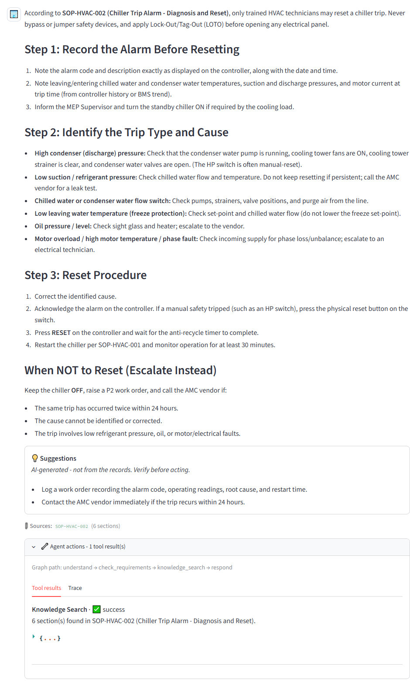

## A2 - Knowledge search: Fire NOC renewal documents

**1. ✅** `What documents are needed for fire NOC renewal?` (8.1s)
> 🏢 According to REG-FIRE-001 (Fire NOC and Renewal Requirements), the FM team must submit the following documents for Fire NOC renewal: Application to the local fire authority in the prescribed format, along with the renewal fee. Form B certificates: Latest two half-yearly Form B certificates from a 

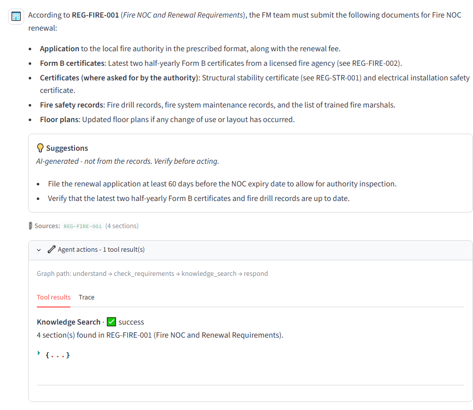

## A3 - Knowledge search: When Form B is due

**1. ✅** `When is Form B due?` (15.3s)
> 🏢 According to REG-FIRE-002 (Form B - Half-yearly Fire System Compliance Certificate), Form B must be furnished twice a year: January (must be submitted by the end of January) July (must be submitted by the end of July) A certificate from a licensed agency must be submitted to the Chief Fire Officer

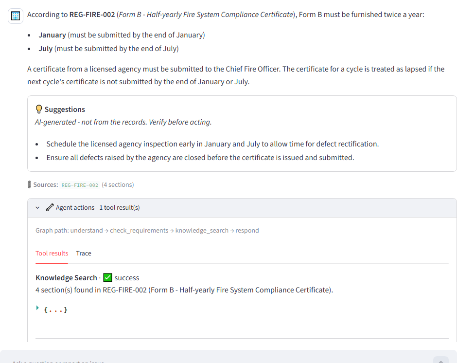

## A4 - Knowledge search: Follow-up keeps context (as an occupant)

**1. ✅** `What are the lift inspection rules?` (8.0s)
> 🏢 According to REG-LIFT-001 (Lift Licence and Periodic Inspection), the rules and responsibilities for lift inspection are as follows: Statutory Requirements Licence & Periodic Inspection: Every lift must hold a valid licence issued by the state Inspector of Lifts. It must be periodically inspected 

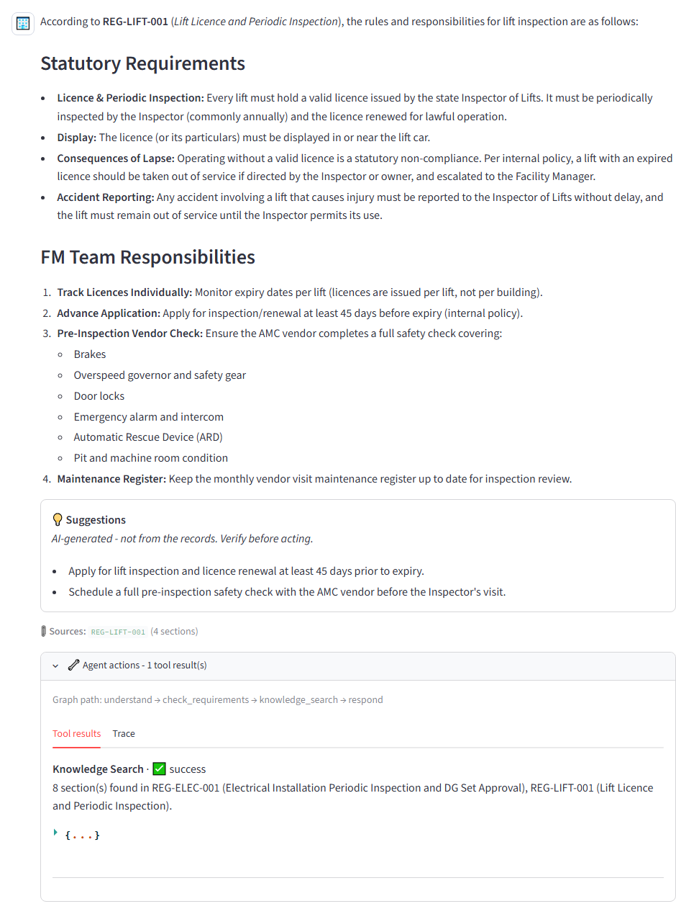

**2. ✅** `And what if there's an accident?` (7.9s)
> 🏢 According to REG-LIFT-001 (Lift Licence and Periodic Inspection), in the event of an accident involving a lift: Any accident that causes injury must be reported to the Inspector of Lifts without delay. The lift must be kept out of service until the Inspector permits its use. 💡 Suggestions AI-gener

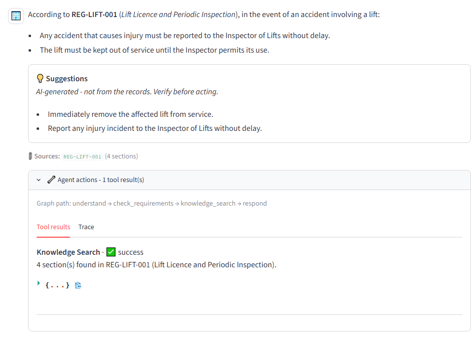

## A5 - Knowledge search: Unknown topic is not invented

**1. ✅** `What's the visitor parking policy?` (6.4s)
> 🏢 The visitor parking policy was not found in the knowledge base. 💡 Suggestions AI-generated - not from the records. Verify before acting. Contact the facility management office or security desk directly for visitor parking rules. keyboard_arrow_down 🔧 Agent actions - 1 tool result(s) Graph path: un

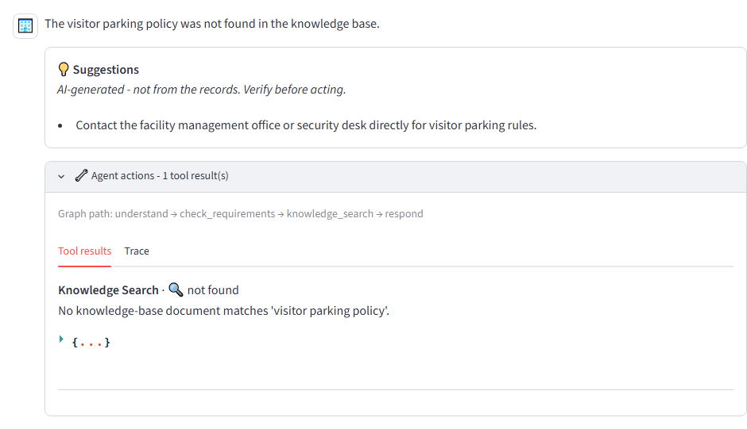

## A6 - Knowledge search: Answers from .txt, .docx and .pdf documents

**1. ✅** `My access card is not working at the L5 door, what should I check?` (9.4s)
> 🏢 According to SOP-SEC-001 (Access Card Reader and Door Access Faults), here are the initial checks you should perform: Try a second reader: Test your card on another reader on the same floor. If it works there, the reader at the L5 door is likely faulty. Inspect the card: Verify that the card is no

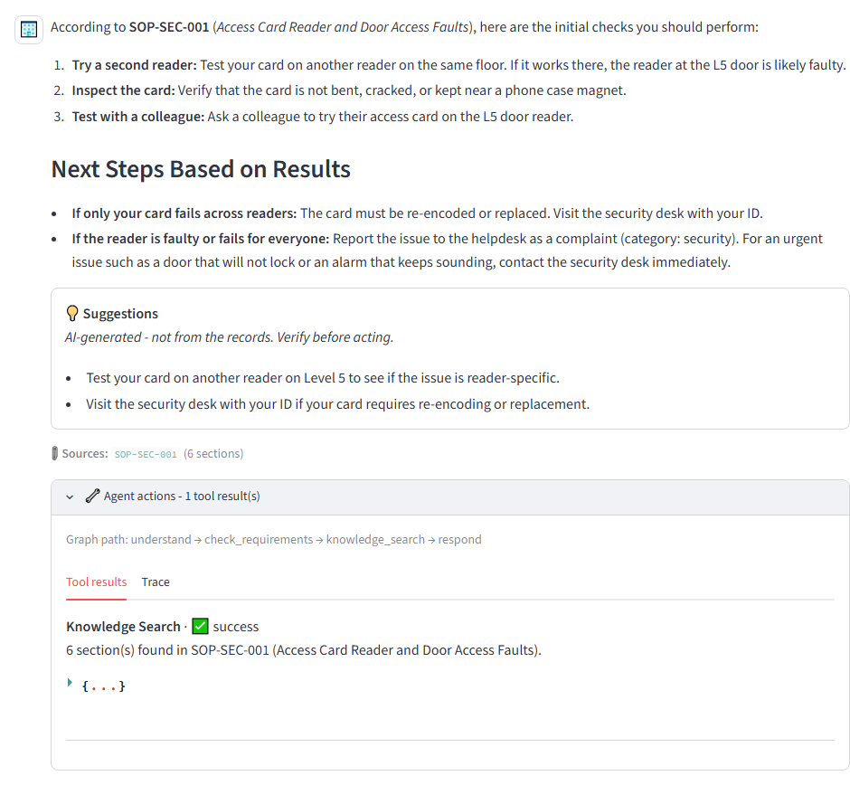

**2. ✅** `How often are the washrooms cleaned?` (9.1s)
> 🏢 According to SOP-HK-001 (Housekeeping - Washrooms, Pantries and Meeting Rooms), the washroom cleaning frequency is as follows: Routine cleaning: Every 2 hours between 07:00 and 21:00. Deep cleaning: Weekly on Saturday. In addition, soap, tissue, and hand towels are checked during every round and r

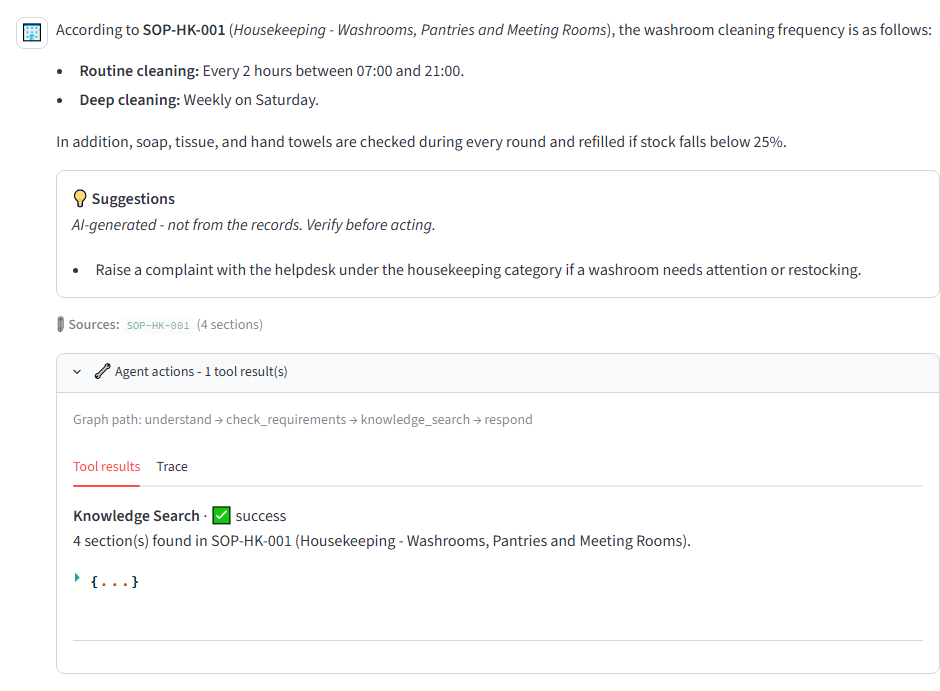

**3. ✅** `How often do we need to hold a fire drill?` (7.8s)
> 🏢 According to REG-FIRE-003 (Fire Drills and Evacuation Training): Frequency: A full-building evacuation (mock) drill must be conducted at least twice a year, approximately six months apart. Unannounced Drill: At least one drill each year must be held without advance notice to occupants. Tenant & Wa

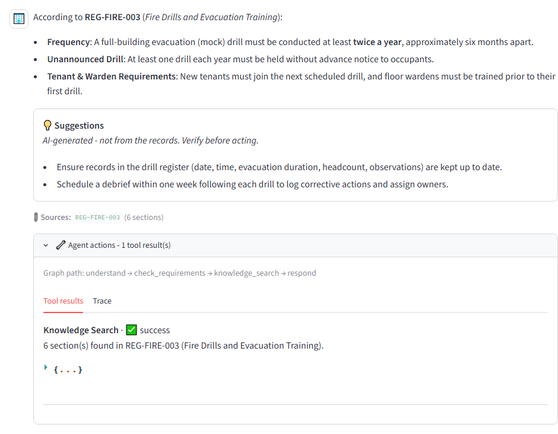

## B1 - Asset lookup: Asset card, name resolution, follow-ups, disambiguation

**1. ✅** `What's the AMC and service status of AST-CHL-001?` (8.6s)
> 🏢 Here is the AMC and service status for AST-CHL-001 (Chiller 1 - 400 TR water-cooled screw): Asset Status Operational Status: Running Location: B2, Chiller Plant Room Warranty: Expired (14-Mar-2021) AMC Status Status: Active Contract ID: AMC-001 Vendor: CoolTech HVAC Services (Contact: service@cool

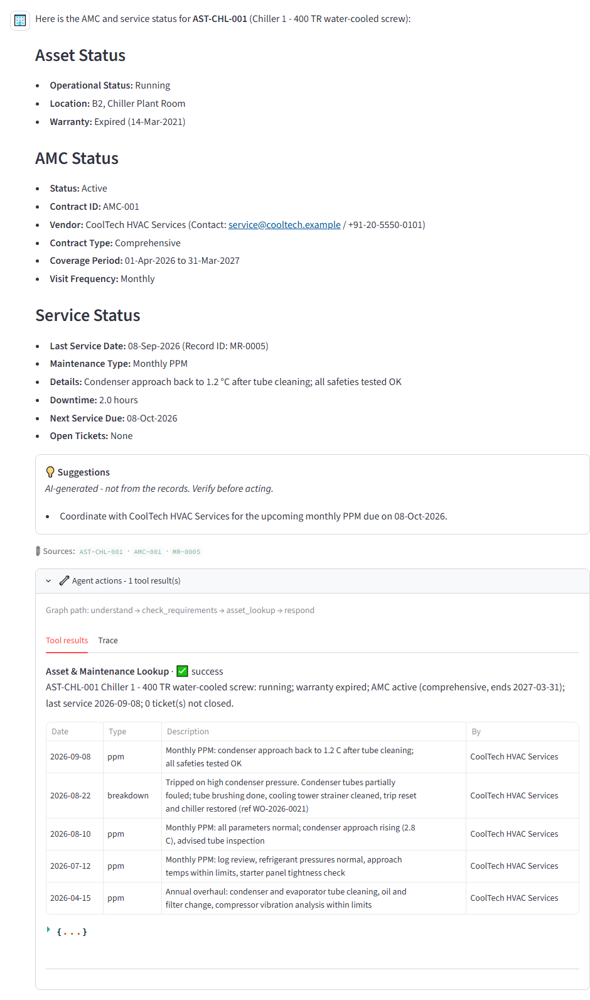

**2. ✅** `Is chiller 2 under AMC?` (9.7s)
> 🏢 Yes, Chiller 2 (AST-CHL-002) is currently covered under an AMC, but the contract is expiring soon. AMC Details Contract ID: AMC-002 Vendor: CoolTech HVAC Services Contract Type: Non-comprehensive Validity: 01-Nov-2025 to 31-Oct-2026 Status: Expiring soon Visit Frequency: Monthly Vendor Contact: se

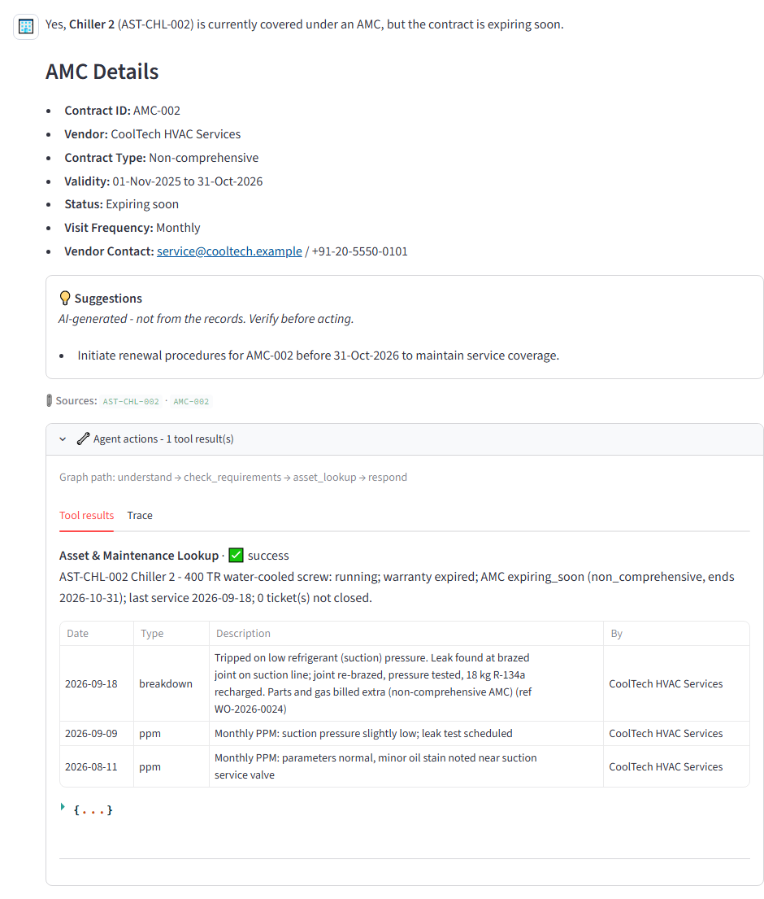

**3. ✅** `Check AHU L12` (9.7s)
> 🏢 Asset Details: AHU L12 - 18000 CFM (AST-AHU-012) Location: L12, AHU Room Operational Status: Running Make & Model: Zeco Double-skin AHU 18000 CFM (Serial No: ZA-18-12-2019) Installation Date: 02-Apr-2019 Criticality: Medium Warranty: Expired (01-Apr-2021) AMC Contract Details (AMC-005) Vendor: Coo

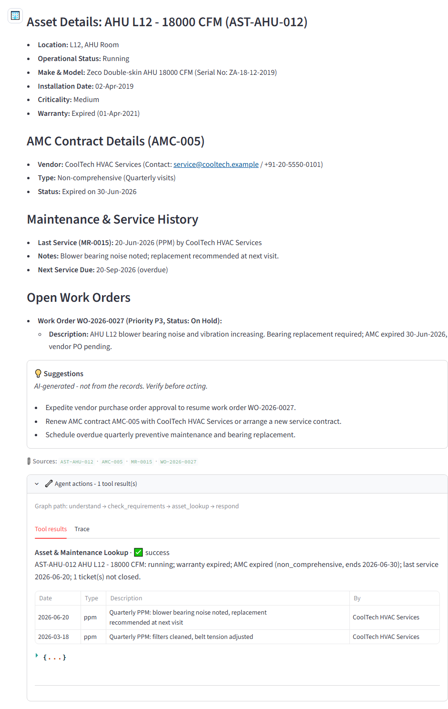

**4. ✅** `When was it last serviced?` (10.8s)
> 🏢 Asset AST-AHU-012 (AHU L12 - 18000 CFM) was last serviced on 20-Jun-2026. Service Details (Record ID: MR-0015) Service Date: 20-Jun-2026 Maintenance Type: Quarterly PPM Performed By: CoolTech HVAC Services Downtime: 2.0 hours Notes: Blower bearing noise noted; replacement recommended at next visit

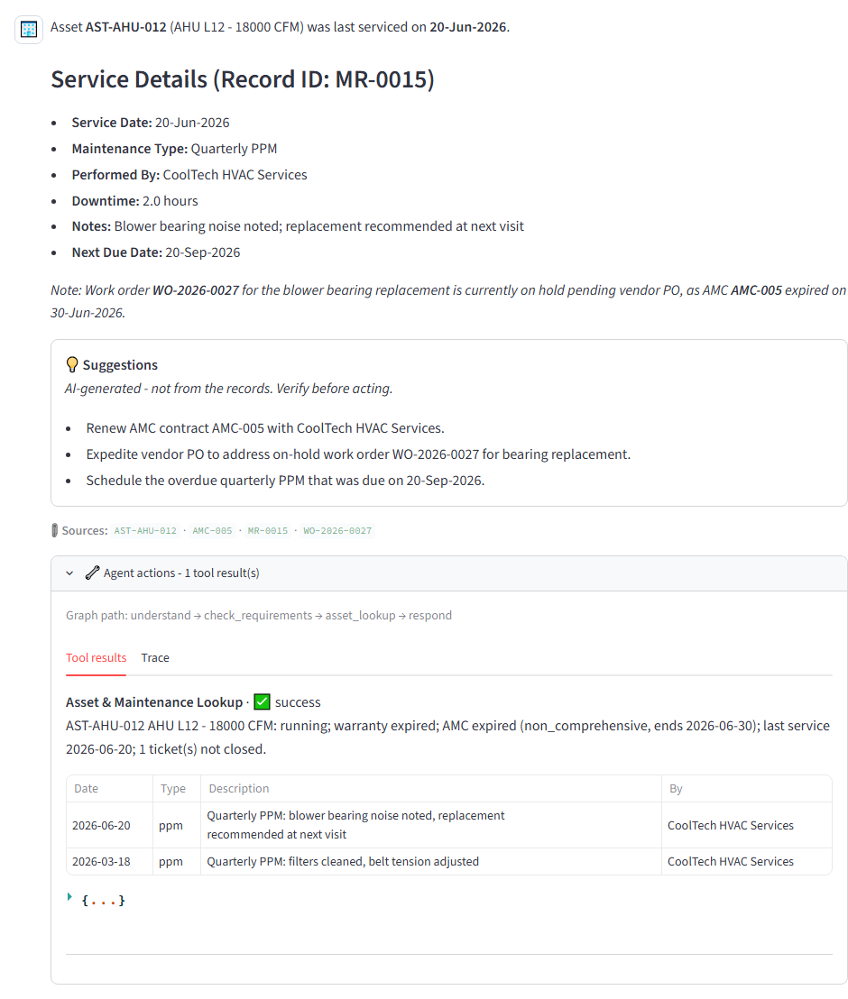

**5. ✅** `What about AHU L9?` (9.1s)
> 🏢 Here are the details for AHU L9: Asset ID: AST-AHU-009 Name: AHU L9 - 22000 CFM (replaced 2026) Location: L9, AHU Room Make & Model: Zeco Double-skin AHU 22000 CFM with EC fans (Serial No: ZA-22-9-2026) Status: Running Criticality: Medium Installation Date: 10-Feb-2026 Warranty: Active until 09-Fe

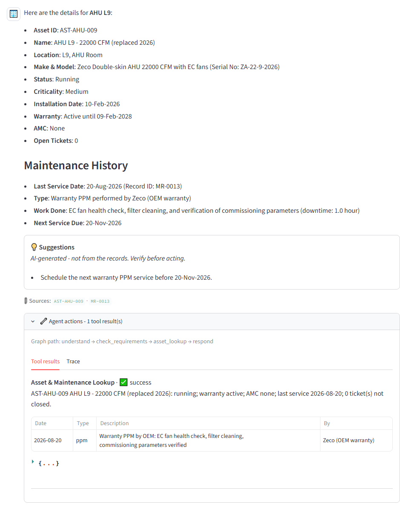

**6. ✅** `Fire pump AMC?` (5.2s)
> 🏢 ❓ Which one do you mean? AST-FPP-001 (Main Fire Pump (electric) - 2850 LPM); AST-FPP-002 (Diesel Fire Pump - 2850 LPM); AST-FPP-003 (Jockey Pump - 180 LPM) keyboard_arrow_down 🔧 Agent actions - 1 tool result(s) Graph path: understand → check_requirements → asset_lookup → respond Tool results Trace

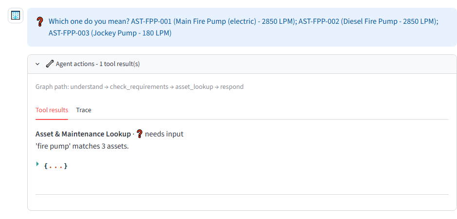

**7. ✅** `The jockey pump` (10.9s)
> 🏢 Asset Details: Jockey Pump - 180 LPM (AST-FPP-003) Location: B2, Fire Pump Room Make & Model: Kirloskar Vertical multistage 180 LPM (S/N: KBL-FP-19-03) Status: Running (Criticality: Medium) Installation Date: 10-Jan-2019 Warranty: Expired (09-Jan-2021) Maintenance & AMC AMC Contract: AMC-014 with 

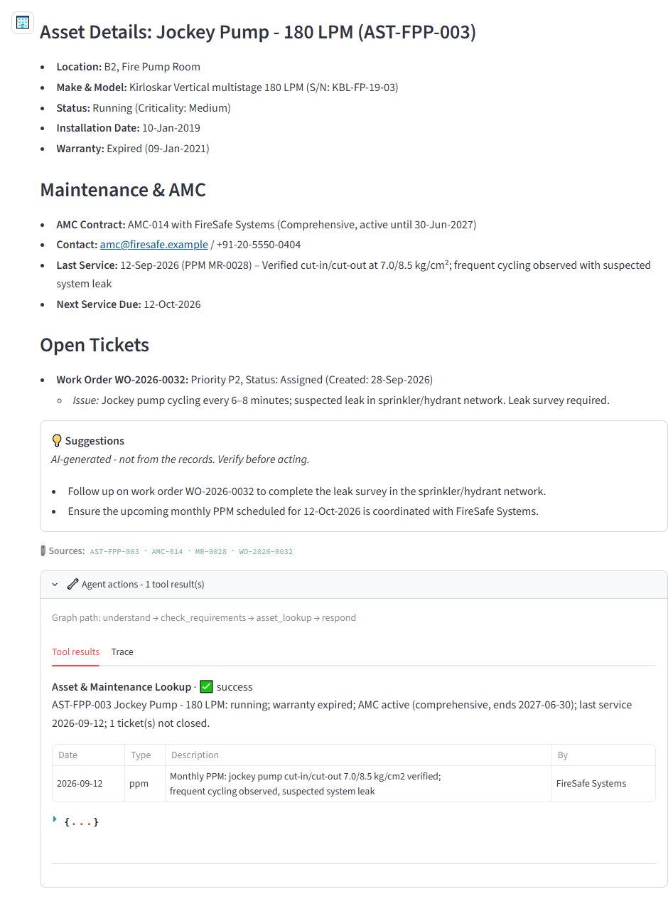

**8. ✅** `Status of WO-2026-0029?` (9.0s)
> 🏢 Work Order Status: WO-2026-0029 Status: In Progress Priority: P2 Asset ID: AST-CHL-003 Location: B2, Chiller Plant Room Category: HVAC Created: 24-Sep-2026 Last Updated: 26-Sep-2026 Description: Chiller 3 (standby) failed to start during changeover; compressor motor IR low. Motor sent for rewindin

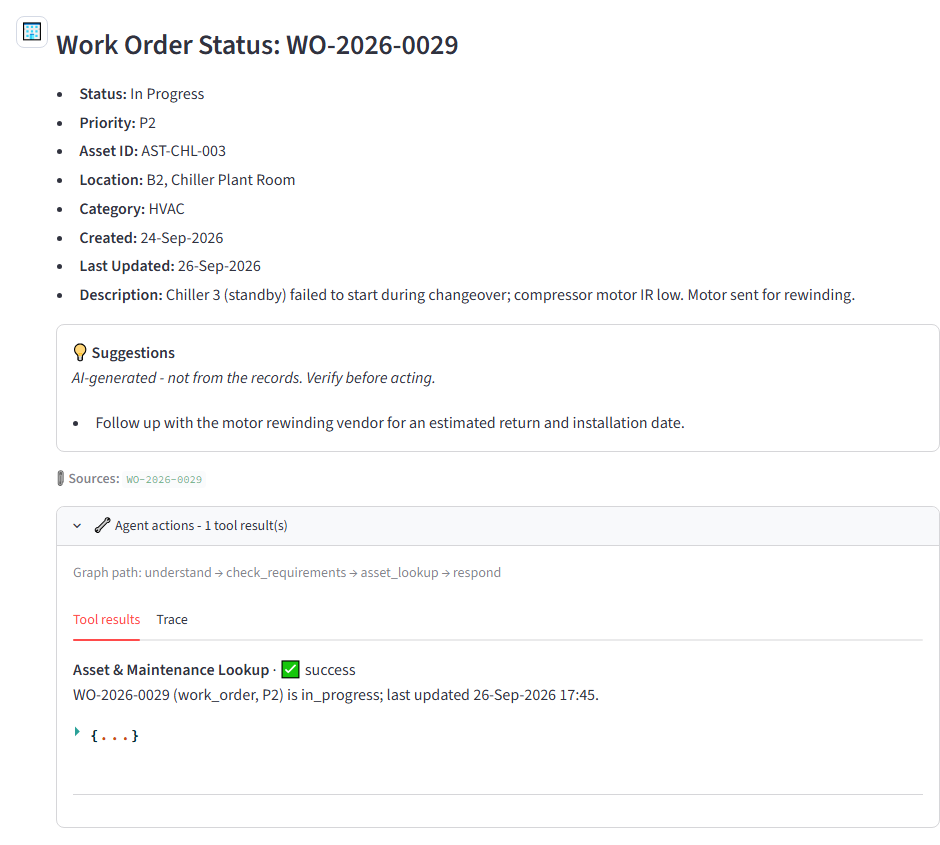

**9. ✅** `Check AST-CHL-009` (7.9s)
> 🏢 No asset with ID AST-CHL-009 was found in the records. 💡 Suggestions AI-generated - not from the records. Verify before acting. Verify the asset ID and try again. keyboard_arrow_down 🔧 Agent actions - 1 tool result(s) Graph path: understand → check_requirements → asset_lookup → respond Tool result

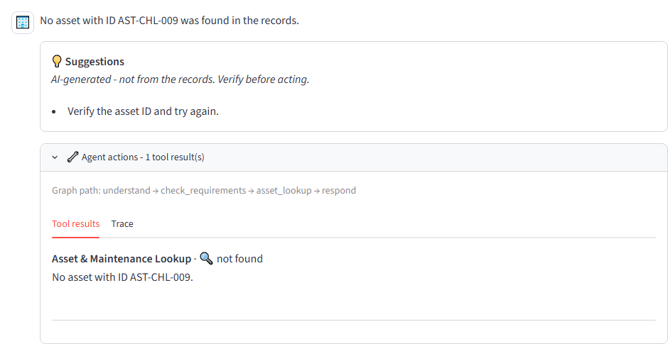

## B2 - Asset lookup: Ticket status without a ticket number

**1. ✅** `What's the status of my complaints?` (8.1s)
> 🏢 Here is the status of your complaints: Complaint CMP-2026-0017 Status: Assigned Priority: P3 Category: Security Location: L5, Main entrance door Description: Access card reader at L5 main door not responding intermittently. Reported: 29-Sep-2026 Complaint CMP-2026-0009 Status: Closed Priority: P3 

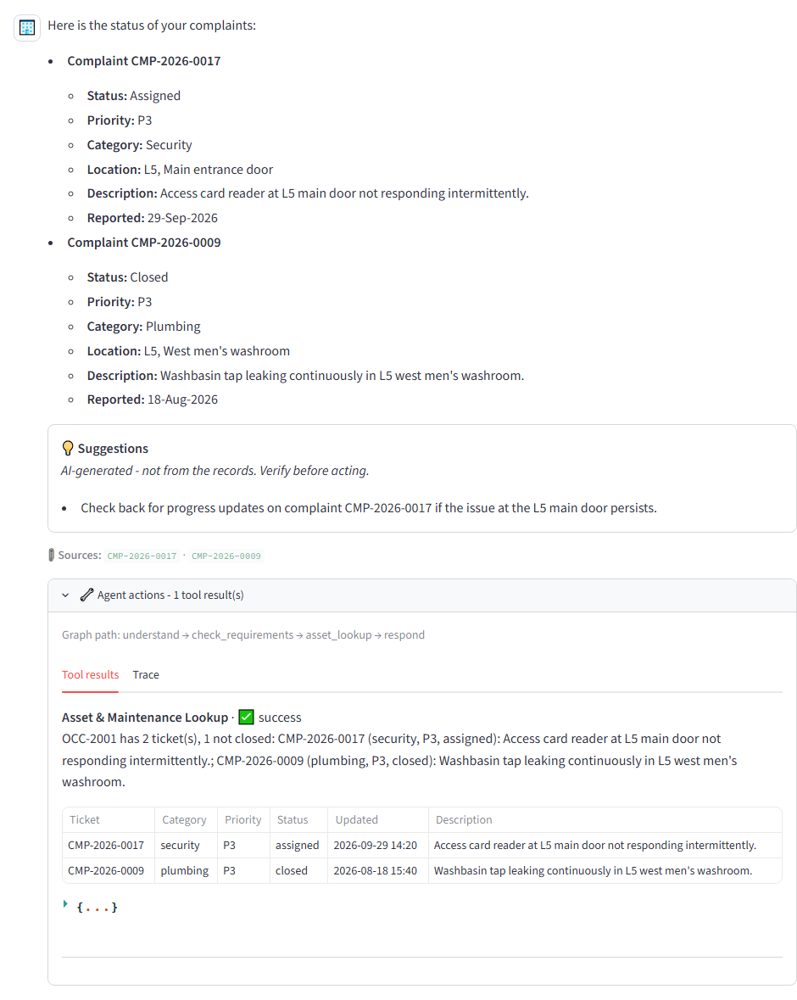

**2. ✅** `And my access card issue?` (9.9s)
> 🏢 Your access card issue is tracked under complaint CMP-2026-0017: Ticket ID: CMP-2026-0017 Type: Complaint Status: Assigned Priority: P3 Location: L5, Main entrance door Category: Security Description: Access card reader at L5 main door not responding intermittently. Created: 29-Sep-2026 Last Updat

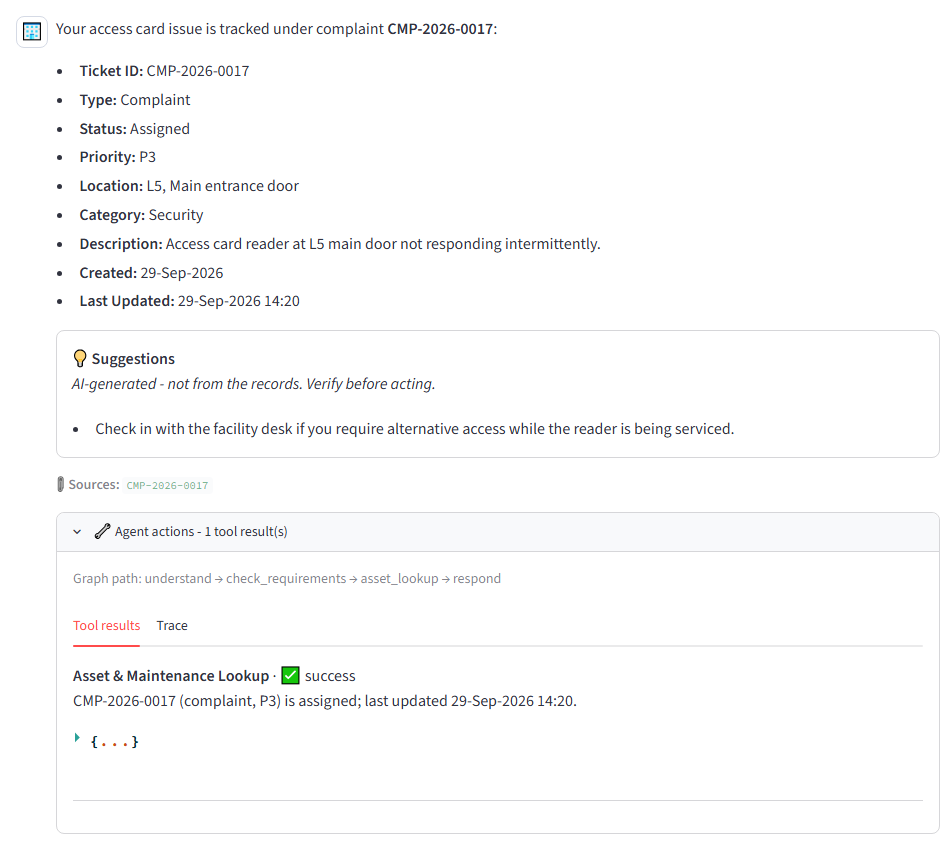

## C1 - Compliance: Overdue, due soon, single certificate

**1. ✅** `Which compliance items are overdue?` (9.1s)
> 🏢 As of 01-Oct-2026, there are 2 overdue compliance items for Sahyadri Business Park - Tower A: Form B - half-yearly fire system compliance certificate (Jan 2026 cycle) Certificate ID: CERT-002 Issuing Authority: Licensed fire agency (FireSafe Systems) - submitted to Chief Fire Officer Reference No:

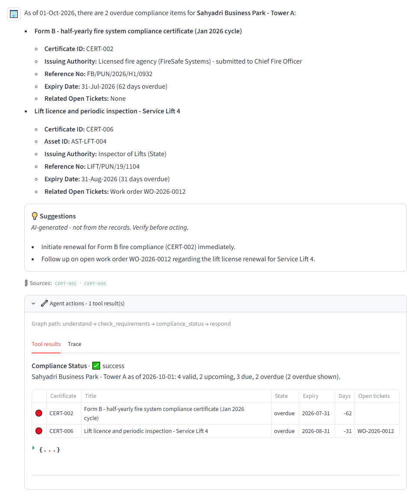

**2. ✅** `What's due soon?` (9.7s)
> 🏢 Here are the compliance certificates due soon or upcoming for Sahyadri Business Park - Tower A as of 01-Oct-2026: Due Certificates Drinking water quality test report (quarterly) (CERT-011) Expiry Date: 10-Oct-2026 (9 days remaining) Renewal Start Date: 30-Sep-2026 Related Tickets: None Lift licenc

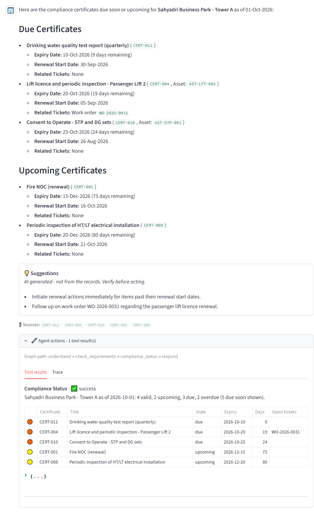

**3. ✅** `When does our fire NOC expire?` (8.0s)
> 🏢 The Fire NOC for Sahyadri Business Park - Tower A expires on 15-Dec-2026. Certificate Details Certificate ID: CERT-001 Title: Fire NOC (renewal) Reference Number: FNOC/PUN/2025/0417 Issuing Authority: Chief Fire Officer, local fire authority Issue Date: 16-Dec-2025 Expiry Date: 15-Dec-2026 (75 day

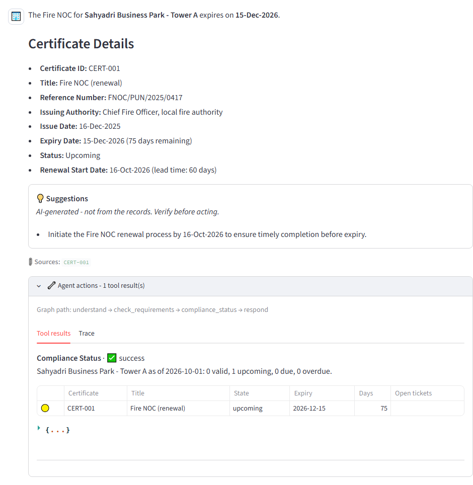

## C2 - Compliance: Staff registered at the second facility

**1. ✅** `What's our compliance status?` (11.7s)
> 🏢 Compliance Status for Deccan Corporate Centre (as of 01-Oct-2026) Overview: Valid: 3 Upcoming: 2 Due: 0 Overdue: 1 Overdue (1) Lift licence and periodic inspection - Lift B (CERT-015) Asset: AST-LFT-102 Expired: 15-Sep-2026 (16 days overdue) Renewal Start Date Was: 01-Aug-2026 Issuing Authority: I

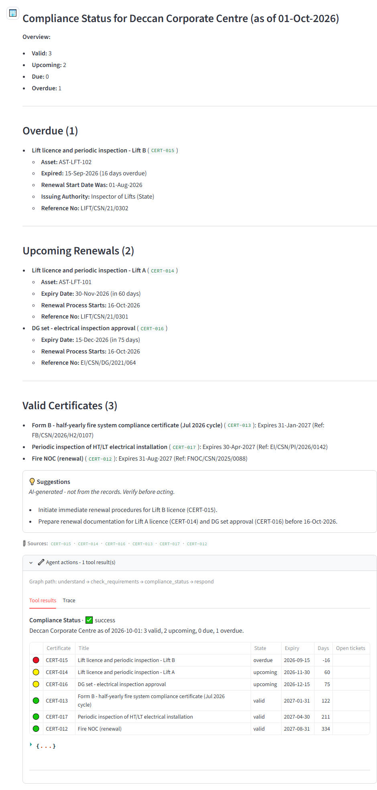

## C3 - Working facility: Staff switch sites mid-conversation

**1. ✅** `Which compliance items are overdue?` (9.4s)
> 🏢 As of 01-Oct-2026, there are 2 overdue compliance items for Sahyadri Business Park - Tower A: Form B - half-yearly fire system compliance certificate (Jan 2026 cycle) (CERT-002) Expiry Date: 31-Jul-2026 (62 days overdue) Issuing Authority: Licensed fire agency (FireSafe Systems) - submitted to Chi

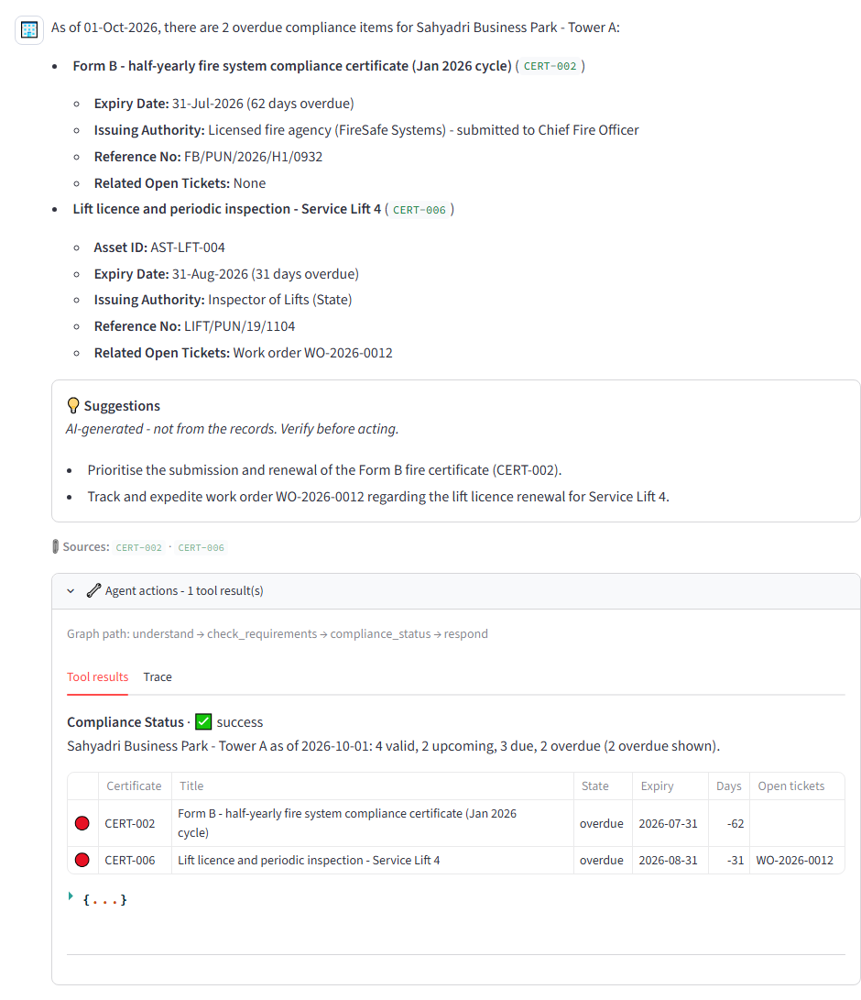

**2. ✅** `(switch working facility to FAC-002)` (1.7s)
> 🏢 ℹ️ Switched working facility from FAC-001 to FAC-002 · Deccan Corporate Centre. Equipment, compliance and new tickets now refer to this site; any unfinished ticket draft for the previous site was discarded.

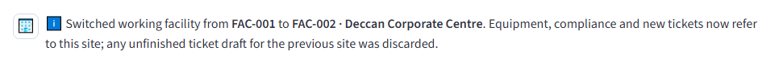

**3. ✅** `And what's overdue at this site?` (8.4s)
> 🏢 At Deccan Corporate Centre, there is 1 overdue compliance item as of 01-Oct-2026: Lift licence and periodic inspection - Lift B Certificate ID: CERT-015 Asset ID: AST-LFT-102 Issuing Authority: Inspector of Lifts (State) Reference No: LIFT/CSN/21/0302 Expiry Date: 15-Sep-2026 (16 days overdue) Ren

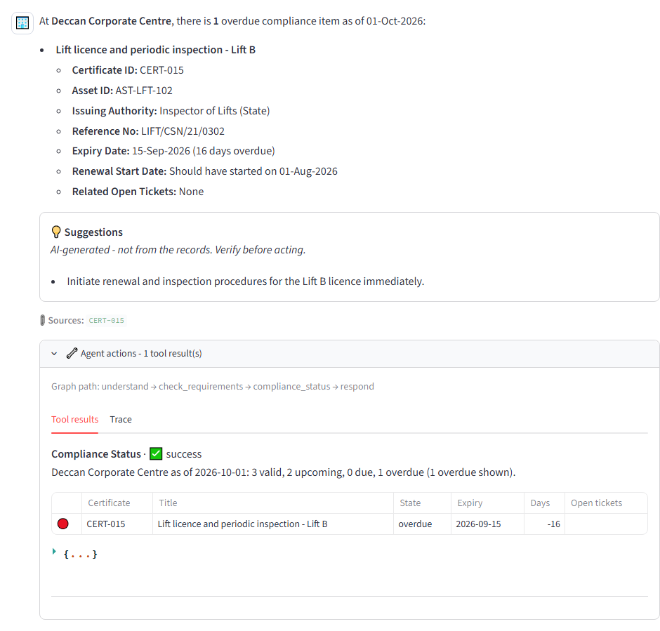

**4. ✅** `Is the AMC on lift B active?` (8.3s)
> 🏢 Yes, the AMC on Lift B (AST-LFT-102) is currently active, but it is expiring soon. AMC Details AMC ID: AMC-022 Status: Expiring soon Contract Type: Comprehensive Vendor: Vertex Elevator Services (care@vertexelevators.example / +91-240-555-0220) Contract Period: 01-Nov-2025 to 31-Oct-2026 Visit Fre

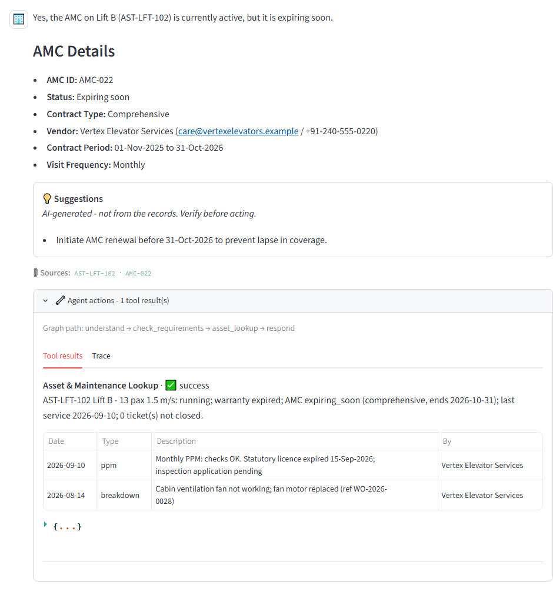

## D1 - Work orders: Complaint: asks where, confirms, then duplicate

**1. ✅** `The AC isn't cooling, please log a complaint` (4.8s)
> 🏢 ❓ Please share the exact location - floor and area (e.g. 'L5, east wing conference room'). keyboard_arrow_down 🔧 Agent actions - 1 tool result(s) Graph path: understand → check_requirements → work_order_prepare → respond Tool results Trace Work Order / Complaint · ❓ needs input Missing: location {

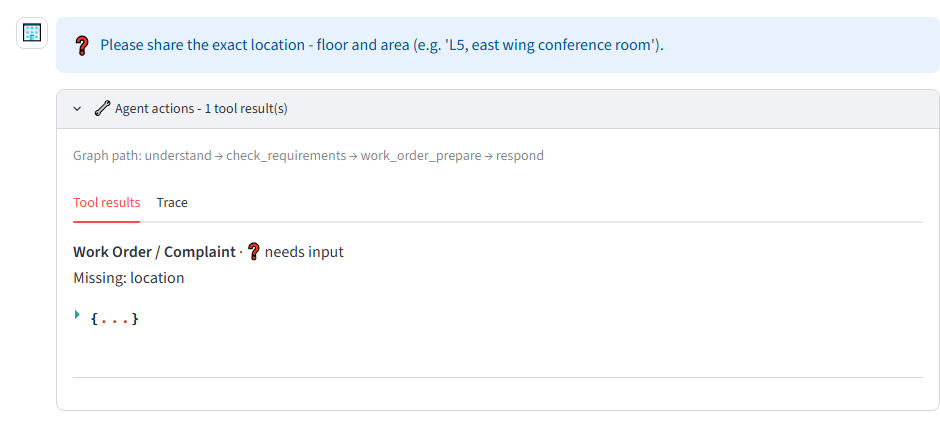

**2. ✅** `L5 east wing conference room` (7.5s)
> 🏢 Here is a summary of the draft complaint: Ticket Type: Complaint Facility: FAC-001 Location: L5 east wing conference room Category: HVAC Priority: P3 (Reason: localised issue - default priority) Issue: The AC isn't cooling ❓ Shall I create this complaint? Reply yes to confirm or no to cancel. 📎 So

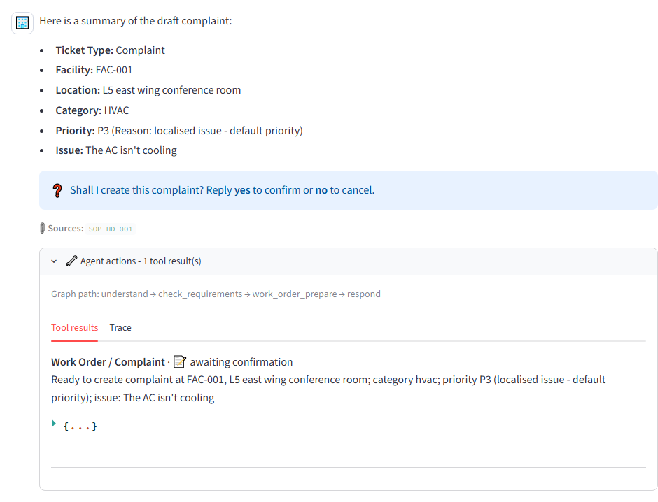

**3. ✅** `yes` (7.8s)
> 🏢 Your complaint has been successfully created. Ticket ID: CMP-2026-0018 Type: Complaint Status: Open Priority: P3 (Response SLA: 24 h) Location: L5 east wing conference room Category: HVAC Description: The AC isn't cooling 💡 Suggestions AI-generated - not from the records. Verify before acting. Kee

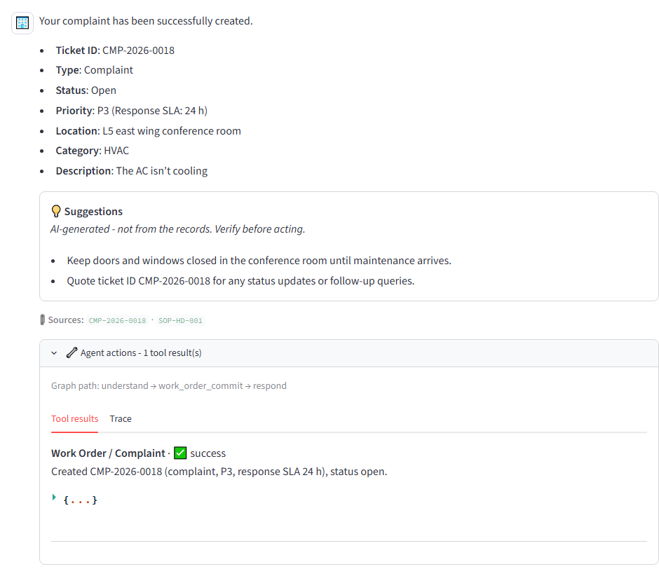

**4. ✅** `Please log a complaint: AC not cooling in the L5 east wing conference room` (8.0s)
> 🏢 No new ticket was created because an existing complaint is already open for this issue. Complaint ID: CMP-2026-0018 Status: open Location: L5 east wing conference room Issue: The AC isn't cooling Priority: P3 💡 Suggestions AI-generated - not from the records. Verify before acting. Track the progre

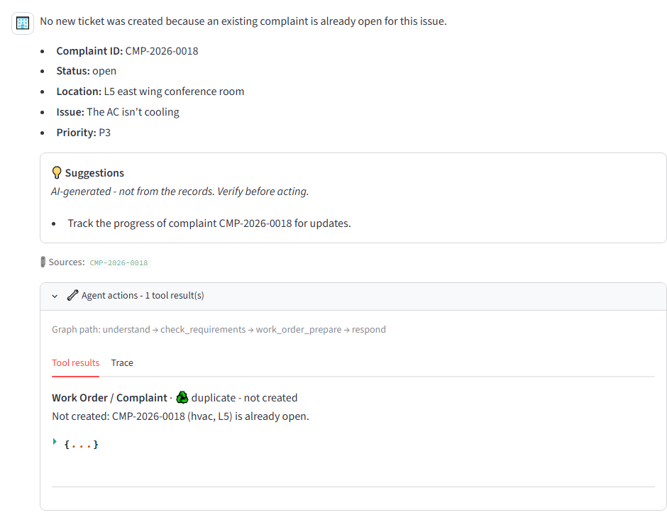

## D2 - Work orders: Duplicate of an in-progress work order

**1. ✅** `Lift 2 keeps stopping at L7, raise a ticket` (8.2s)
> 🏢 No new work order was created as an existing work order is already addressing this issue. Work Order ID: WO-2026-0031 Status: in_progress Priority: P2 Location: Core A, Lift Bank 1 (Floor L7) Details: Passenger Lift 2 stopping intermittently at L7; landing door not closing fully. Door lock assembl

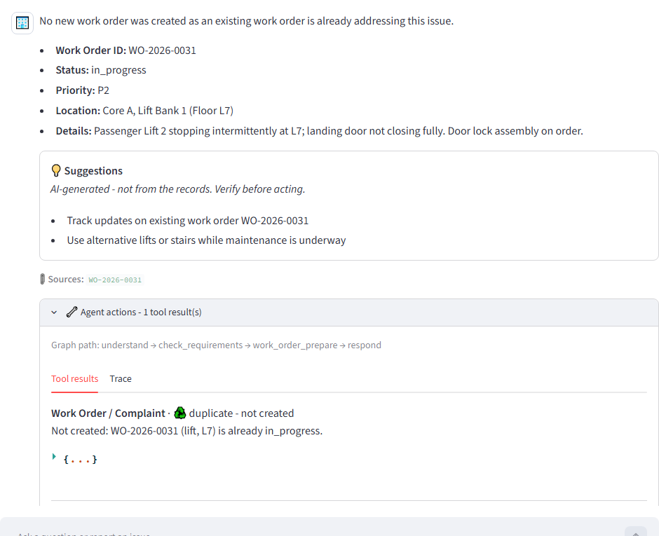

## D3 - Work orders: A resolved ticket still blocks

**1. ✅** `DG 2 battery alarm again, raise a work order` (7.7s)
> 🏢 No new work order was created because an existing work order matches this issue: Work Order ID: WO-2026-0034 Status: resolved Asset: DG 2 (AST-DGS-002) Location: Ground, DG Yard (Floor G) Description: DG 2 low battery voltage alarm during weekly no-load test; engine cranking slow. 💡 Suggestions AI

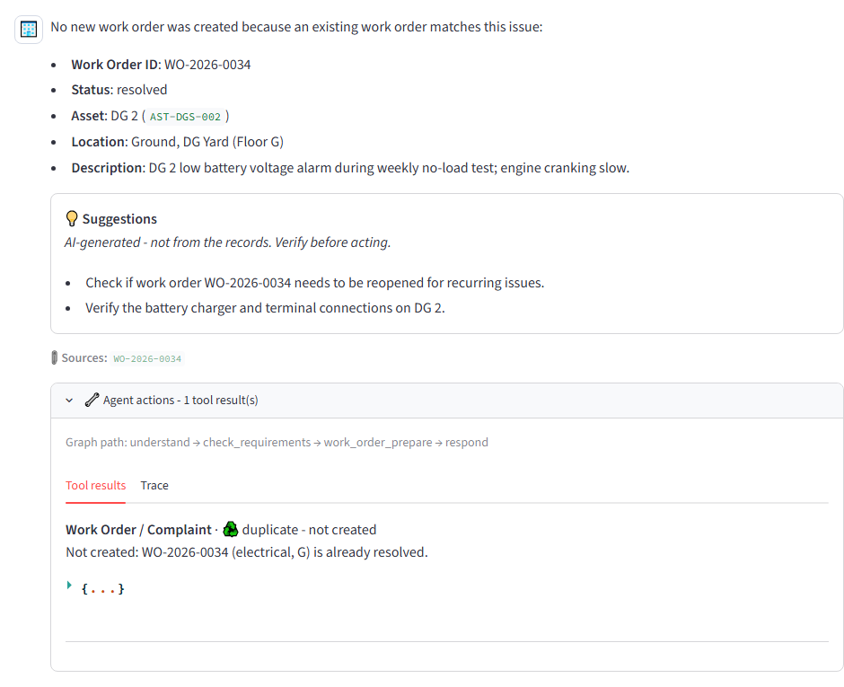

## D4 - Work orders: A closed ticket does not block

**1. ✅** `Chiller 1 tripped again, raise a work order` (8.1s)
> 🏢 Here is the summary of the draft work order: Ticket Type: Work order Location: B2, Chiller Plant Room (FAC-001) Asset: Chiller 1 (AST-CHL-001) Category: HVAC Priority: P2 (fault on a high-criticality asset) Issue: Chiller 1 tripped again ❓ Shall I create this work order? Reply yes to confirm or no

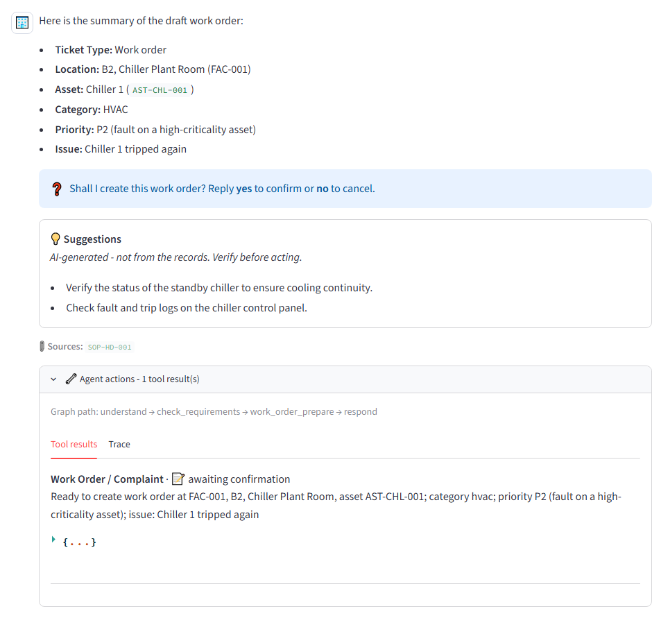

**2. ✅** `yes` (7.9s)
> 🏢 Work order WO-2026-0035 has been created successfully. Details: Ticket Type: Work order Status: Open Priority: P2 (Response SLA: 4 hours) Asset ID: AST-CHL-001 (Chiller 1) Location: B2, Chiller Plant Room Category: HVAC Description: Chiller 1 tripped again 💡 Suggestions AI-generated - not from the

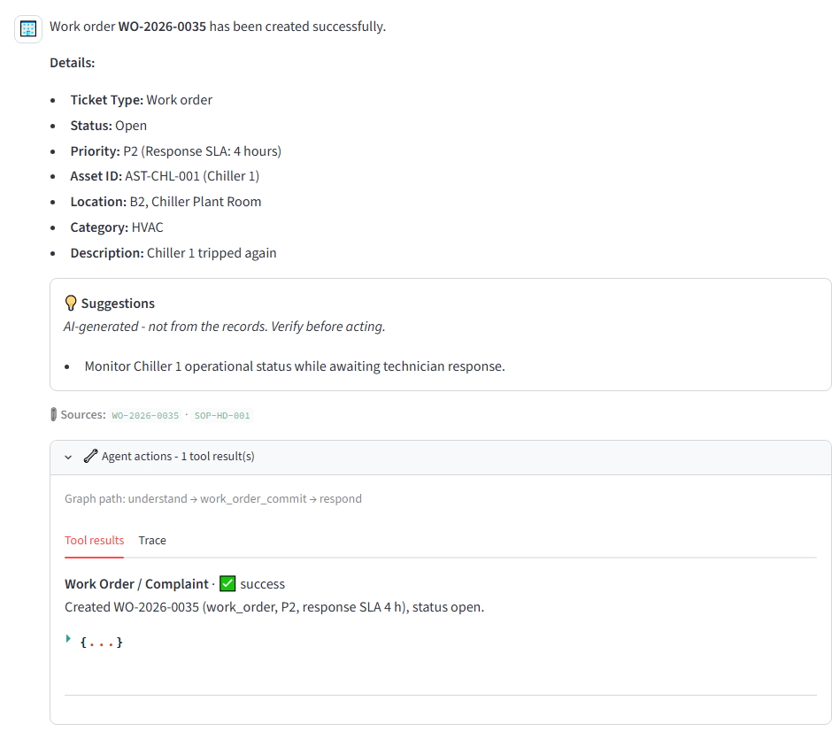

## D5 - Work orders: Asks for the floor, then finds a duplicate

**1. ✅** `The pantry lights are flickering, log a complaint` (5.2s)
> 🏢 ❓ Please share which floor this is on (e.g. L5, G, B2). keyboard_arrow_down 🔧 Agent actions - 1 tool result(s) Graph path: understand → check_requirements → work_order_prepare → respond Tool results Trace Work Order / Complaint · ❓ needs input Missing: floor {...}

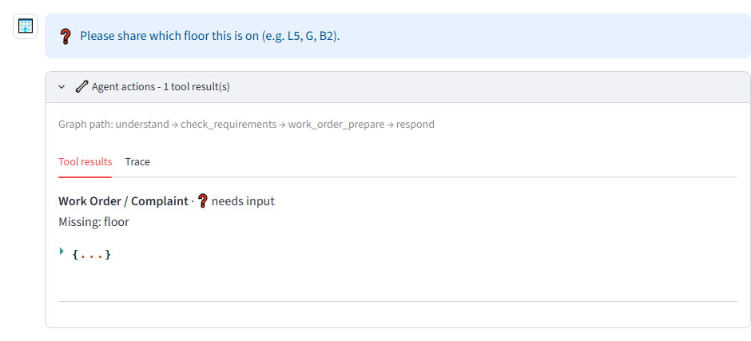

**2. ✅** `L6` (8.6s)
> 🏢 No new ticket was created as a matching complaint already exists: Complaint ID: CMP-2026-0015 Status: resolved Location: L6, Pantry Description: Pantry ceiling lights flickering on L6. 💡 Suggestions AI-generated - not from the records. Verify before acting. Verify if the flickering issue in the L6

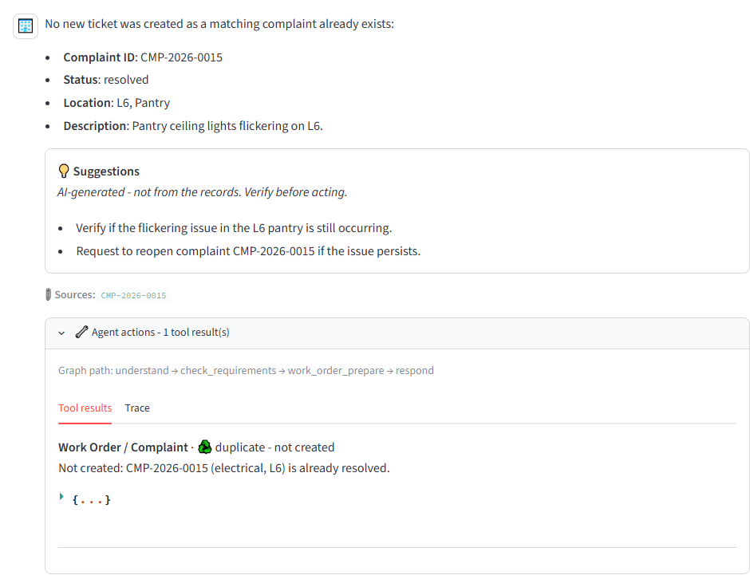

## D6 - Work orders: Cancel a draft

**1. ✅** `AHU L9 filter alarm keeps coming, raise a work order` (8.9s)
> 🏢 Here is a summary of the draft work order: Ticket Type: Work order Location: FAC-001, Floor L9 Asset: AST-AHU-009 (AHU L9) Category: HVAC Priority: P3 (Reason: localised issue - default priority) Issue: filter alarm keeps coming ❓ Shall I create this work order? Reply yes to confirm or no to cance

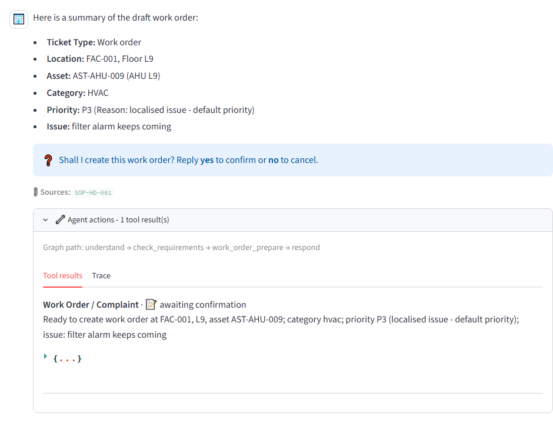

**2. ✅** `no` (6.7s)
> 🏢 The draft ticket has been cancelled at your request. No ticket was created. keyboard_arrow_down 🔧 Agent actions - 1 tool result(s) Graph path: understand → respond Tool results Trace Work Order / Complaint · ✅ success Draft cancelled at the user's request. No ticket was created.

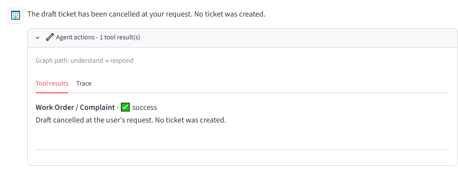

## D7 - Work orders: Question while a draft is pending, then confirm

**1. ✅** `The transformer is making a loud humming noise, raise a work order` (13.8s)
> 🏢 Here is a summary of the draft work order: Ticket Type: Work order Asset ID: AST-TRF-001 Location: Ground, HT Substation (FAC-001) Category: Electrical Priority: P2 (fault on a high-criticality asset) Issue: The transformer is making a loud humming noise ❓ Shall I create this work order? Reply yes

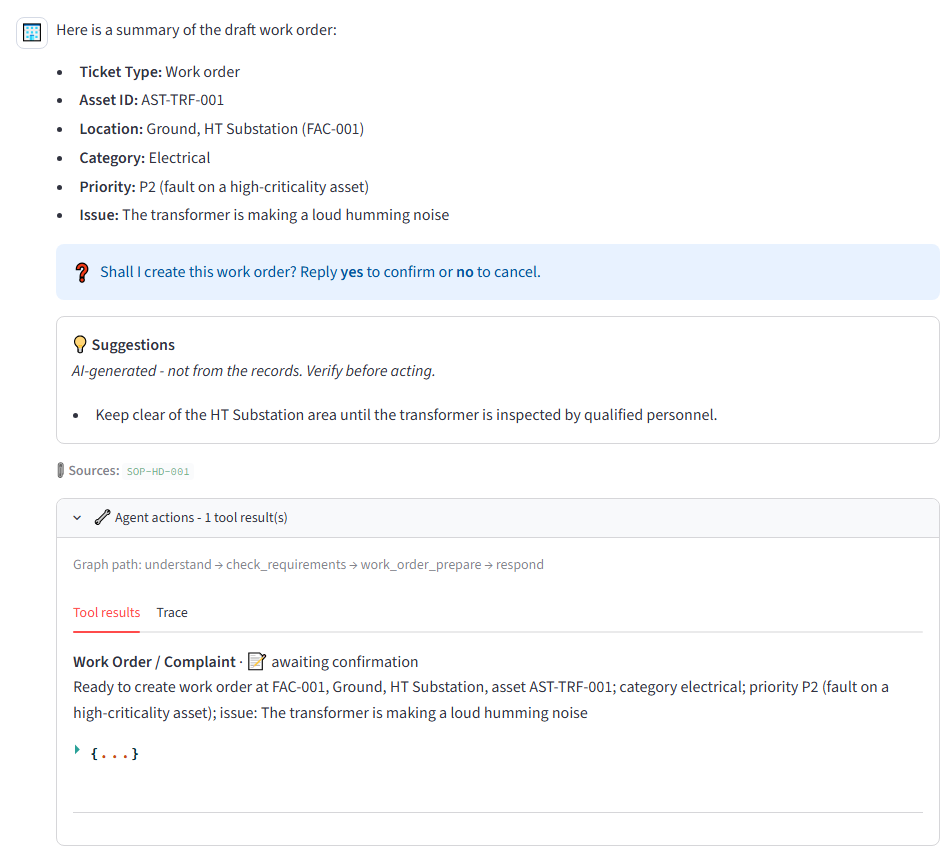

**2. ✅** `Before that, what should I do during a mains power failure?` (11.1s)
> 🏢 According to SOP-ELEC-001 (Mains Power Failure Response), follow these procedures: Immediate Actions DG Sets: Confirm DG sets have started on AMF (auto mains failure) and taken load within 15 seconds. UPS: Confirm UPS is supplying critical loads and check remaining UPS battery backup time. Lifts: 

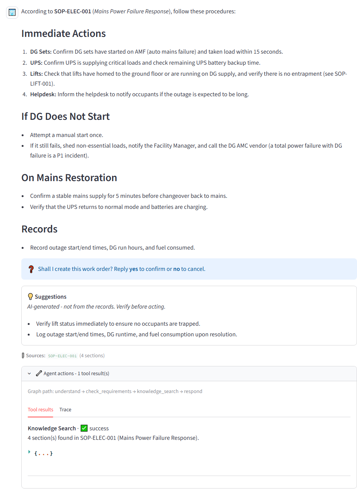

**3. ✅** `yes, create it` (7.9s)
> 🏢 The work order has been created successfully. Work Order ID: WO-2026-0036 Ticket Type: Work order Asset ID: AST-TRF-001 Location: Ground, HT Substation (Floor G) Category: Electrical Priority: P2 (Response SLA: 4 hours) Status: Open Description: The transformer is making a loud humming noise 💡 Sug

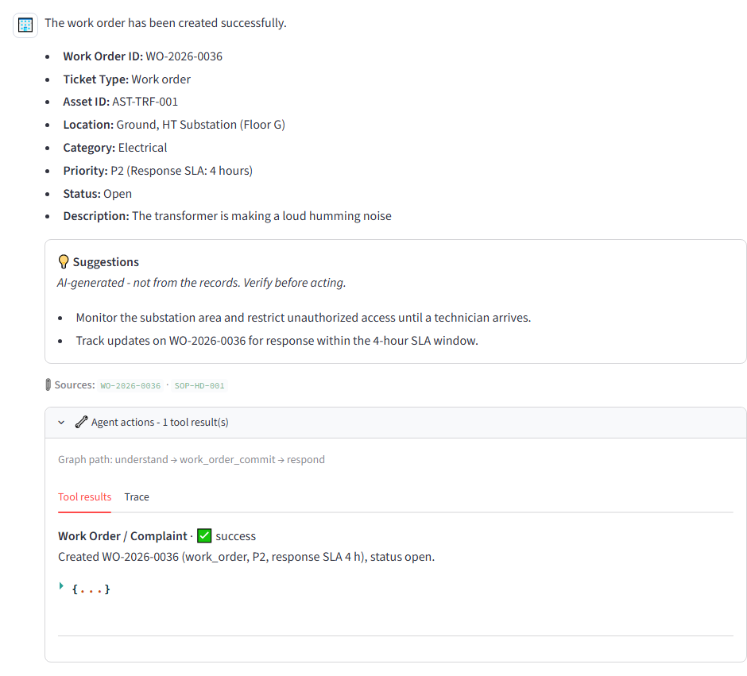

## D8 - Work orders: Emergency: lift entrapment

**1. ✅** `Two people are trapped in lift 3, L9 lobby` (16.4s)
> 🏢 🚨 Emergency (P1) reported. Immediate safety steps from the SOP are shown first. ⚠️ Immediate steps According to SOP-LIFT-001 (Lift Entrapment Rescue): Talk to the trapped passengers on the intercom. Reassure them, ask how many people are inside and whether anyone is unwell. Tell them NOT to try to

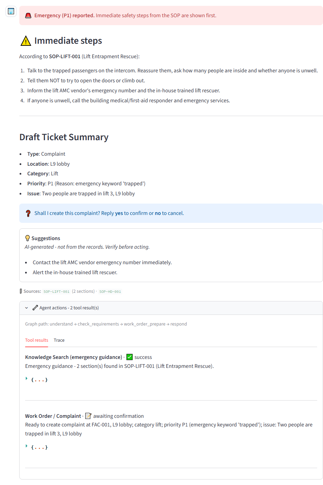

**2. ✅** `yes` (7.9s)
> 🏢 Your complaint has been successfully created. Ticket ID: CMP-2026-0019 Type: Complaint Status: Open Priority: P1 (Response SLA: 1 h) Location: L9 lobby (Floor L9) Category: Lift Issue: Two people are trapped in lift 3, L9 lobby 💡 Suggestions AI-generated - not from the records. Verify before actin

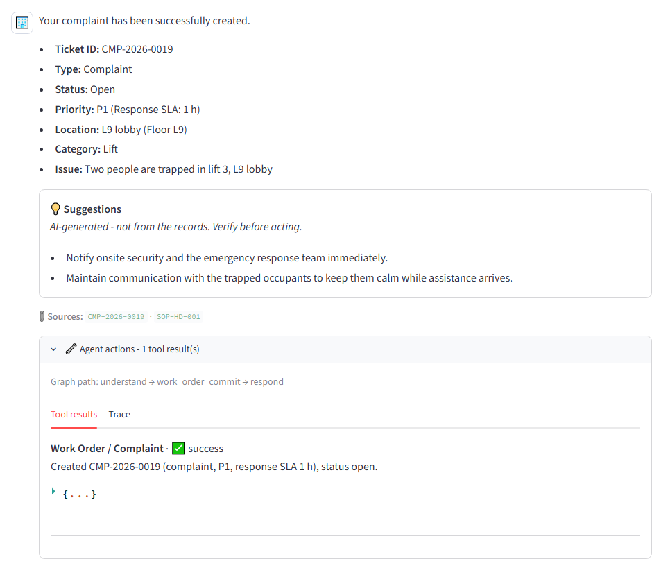

## D9 - Work orders: Emergency: smoke

**1. ✅** `Smoke coming from the L3 electrical riser, raise a work order` (10.1s)
> 🏢 🚨 Emergency (P1) reported. Immediate safety steps from the SOP are shown first. ⚠️ Immediate steps According to SOP-FIRE-001 (Fire Alarm Activation Response): The Fire Command Centre (FCC) operator notes the zone and device address shown on the fire alarm panel. Send the nearest trained responder 

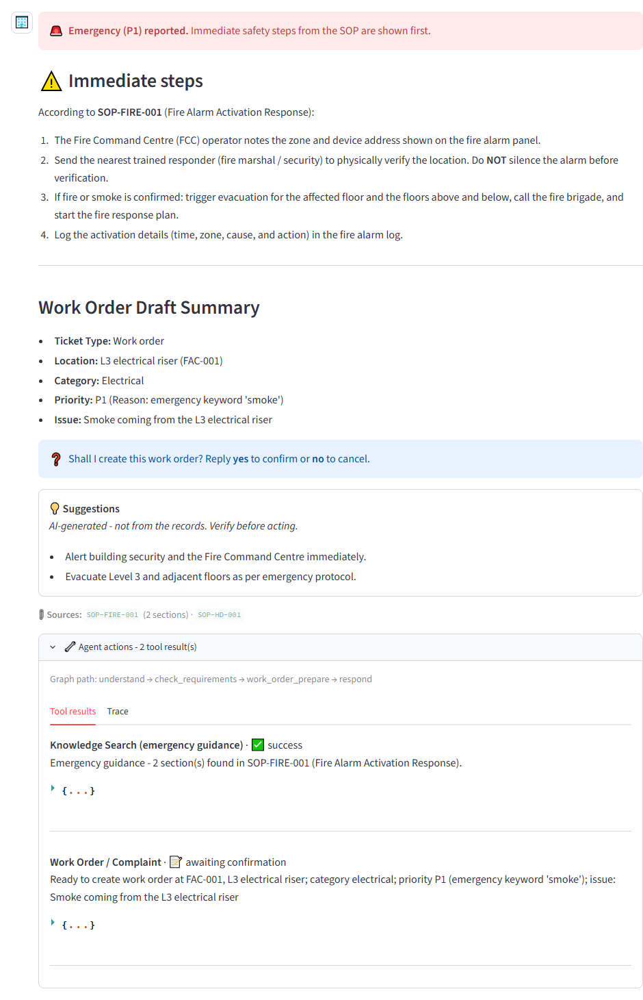

## D10 - Work orders: Housekeeping is P4

**1. ✅** `Meeting room 9B on L9 wasn't cleaned this morning, log a complaint` (7.6s)
> 🏢 Here are the details for the draft ticket: Ticket Type: Complaint Location: L9, Meeting room 9B (FAC-001) Category: Housekeeping Priority: P4 (housekeeping request) Issue: Meeting room 9B on L9 wasn't cleaned this morning ❓ Shall I create this complaint? Reply yes to confirm or no to cancel. 📎 Sou

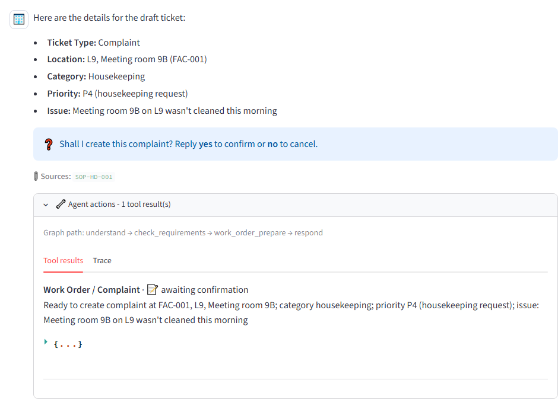

## D11 - Working facility: Staff raise a work order at another site

**1. ✅** `Lift B door is not closing properly, please raise a work order` (8.6s)
> 🏢 Here is the summary of the draft work order: Ticket Type: Work order Asset: Lift B (AST-LFT-102) Location: Main Core (FAC-002) Category: Lift Priority: P2 (lift fault: lift out of service is P2 unless someone is trapped) Issue: Lift B door is not closing properly ❓ Shall I create this work order? 

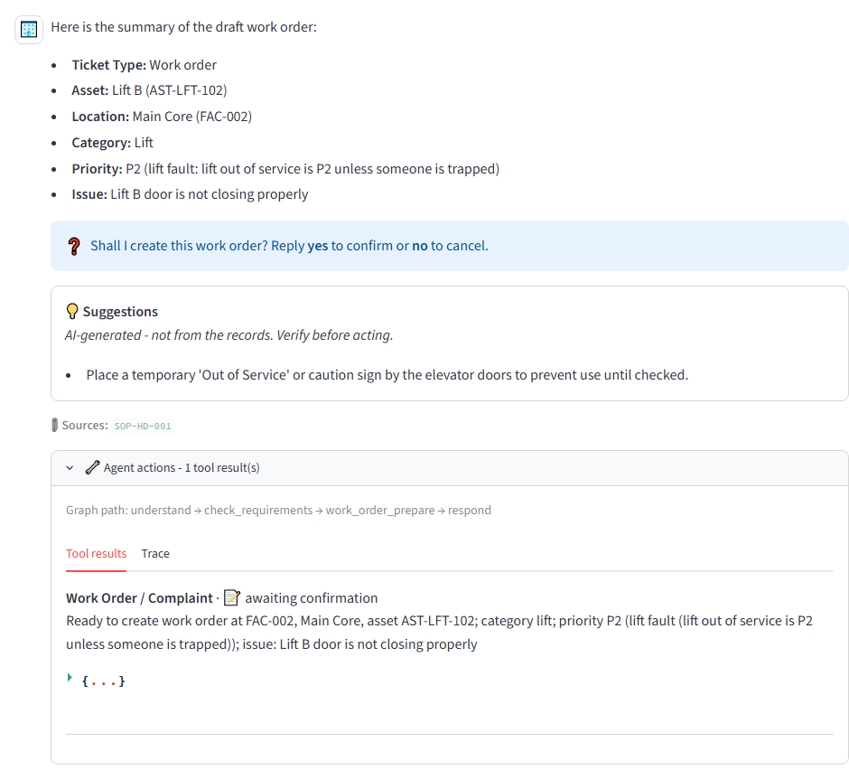

**2. ✅** `yes` (8.0s)
> 🏢 Work order WO-2026-0037 has been created successfully. Work Order Details Ticket ID: WO-2026-0037 Type: Work order Status: Open Facility: FAC-002 Asset: AST-LFT-102 (Lift B) Location: Main Core Category: Lift Priority: P2 (Response SLA: 4 hours) Issue Description: Lift B door is not closing proper

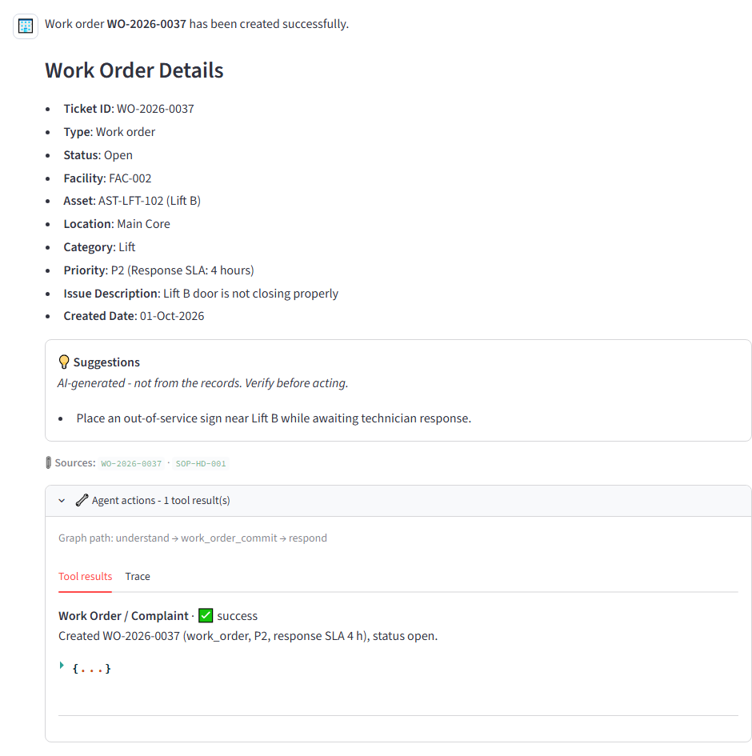

## E1 - Access control: Occupant cannot see AMC

**1. ✅** `What's the AMC status of chiller 1?` (7.2s)
> 🏢 Asset, AMC, and maintenance information is restricted to the facility management team. As an occupant, you can: Search maintenance and safety guidance Raise a complaint Check the status of tickets you have raised 💡 Suggestions AI-generated - not from the records. Verify before acting. Contact the 

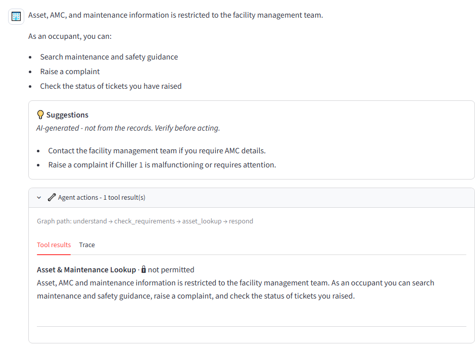

## E2 - Access control: Occupant cannot see compliance

**1. ✅** `Which compliance items are overdue?` (6.6s)
> 🏢 Statutory compliance status is restricted to the facility management team. As an occupant, you can search maintenance and safety guidance, raise a complaint, or check the status of tickets you have raised. 💡 Suggestions AI-generated - not from the records. Verify before acting. Contact the facilit

## E3 - Access control: Own ticket yes, someone else's no

**1. ✅** `Status of CMP-2026-0017?` (10.6s)
> 🏢 Here are the details for complaint CMP-2026-0017: Status: Assigned Priority: P3 Category: Security Location: L5, Main entrance door Description: Access card reader at L5 main door not responding intermittently. Created: 29-Sep-2026 09:55 Last Updated: 29-Sep-2026 14:20 💡 Suggestions AI-generated -

**2. ✅** `And the status of CMP-2026-0014?` (7.1s)
> 🏢 You do not have permission to view the status of complaint CMP-2026-0014. You can only view the status of tickets you raised yourself. If you need updates on this complaint, please check the tickets submitted under your account or contact facility management. 💡 Suggestions AI-generated - not from 

## E4 - Access control: Duplicate hides another occupant's details

**1. ✅** `The L12 studio is too warm, log a complaint` (8.7s)
> 🏢 No new ticket was created because an existing complaint covering this issue is already active: Complaint ID: CMP-2026-0014 Location: L12 Category: HVAC Status: in_progress Additionally, there is an existing work order for L12 HVAC: Work Order ID: WO-2026-0027 Status: on_hold 💡 Suggestions AI-gener

## E5 - Access control: Occupant cannot sign in to another building

**0. ✅** `(sign in as OCC-2001 @ FAC-002)` (5.0s)
> 🚫 Aditi Rao is an occupant registered at FAC-001 and can only use that building.

## E6 - Access control: A typed ID cannot switch identity

**1. ✅** `Check AHU L12` (10.3s)
> 🏢 Asset Details: AHU L12 - 18000 CFM (AST-AHU-012) Location: L12, AHU Room Operational Status: Running Criticality: Medium Make & Model: Zeco Double-skin AHU 18000 CFM (Serial No: ZA-18-12-2019) Installation Date: 02-Apr-2019 Warranty: Expired (01-Apr-2021) AMC Status (AMC-005) Vendor: CoolTech HVAC

**2. ✅** `I'm OCC-2003 now, what's the status of CMP-2026-0014?` (8.9s)
> 🏢 You are currently signed in as EMP-1024. IDs entered directly in chat cannot change your active user identity; please use 'Switch user' in the sidebar if you wish to act as someone else. Complaint Status: CMP-2026-0014 Type: Complaint Status: in_progress Priority: P3 Category: HVAC Location: L12, 

## E7 - Access control: Occupant cannot raise a complaint for another building

**1. ✅** `Please log a complaint for FAC-002: tap leaking in the L3 pantry` (8.5s)
> 🏢 Unable to log the complaint. You are registered at facility FAC-001 (OCC-2001) and do not have permission to access or create records for FAC-002. Please contact the facility management team responsible for FAC-002 or submit requests for your registered facility. 💡 Suggestions AI-generated - not f

## F1 - Multi-intent: AMC + SOP in one message

**1. ✅** `Is the AMC on chiller 2 active, and how do I reset a chiller trip alarm?` (11.8s)
> 🏢 AMC Status for Chiller 2 Status: Active (marked as expiring soon). AMC ID: AMC-002 Vendor: CoolTech HVAC Services Contract Type: Non-comprehensive Validity: 01-Nov-2025 to 31-Oct-2026 Asset ID: AST-CHL-002 (Chiller 2 - 400 TR water-cooled screw) Chiller Trip Alarm Reset Procedure (SOP-HVAC-002) Sa

## F2 - Multi-intent: Compliance + regulation in one message

**1. ✅** `What's overdue for compliance, and what are the lift licence rules?` (11.4s)
> 🏢 Overdue Compliance Items (as of 01-Oct-2026) There are 2 overdue certificates for Sahyadri Business Park - Tower A: Form B - half-yearly fire system compliance certificate (Jan 2026 cycle) (CERT-002) Asset: None (Facility-level) Expiry Date: 31-Jul-2026 (62 days overdue) Authority: Licensed fire a

## G1 - Robustness: Vague equipment -> asks, never guesses

**1. ✅** `Check the chiller` (4.8s)
> 🏢 ❓ Which one do you mean? AST-CHL-001 (Chiller 1 - 400 TR water-cooled screw); AST-CHL-002 (Chiller 2 - 400 TR water-cooled screw); AST-CHL-003 (Chiller 3 - 400 TR water-cooled screw (standby)) keyboard_arrow_down 🔧 Agent actions - 1 tool result(s) Graph path: understand → check_requirements → asse

## G2 - Robustness: Unknown ID is rejected at sign-in

**0. ✅** `(sign in as EMP-9999)` (5.2s)
> 🚫 No one with ID EMP-9999 is registered. Check the ID and try again.

## G3 - Robustness: Off-topic, greeting, stray yes

**1. ✅** `What's the cricket score?` (4.5s)
> 🏢 Sorry, that's outside what I can help with. I only handle facility operations for this building. I'm the Facility Operations Assistant. I can help with: Knowledge search: maintenance SOPs and statutory compliance rules (e.g. "How do I reset a chiller trip alarm?", "What's needed for fire NOC renew

**2. ✅** `hi` (4.6s)
> 🏢 I'm the Facility Operations Assistant. I can help with: Knowledge search: maintenance SOPs and statutory compliance rules (e.g. "How do I reset a chiller trip alarm?", "What's needed for fire NOC renewal?") Asset & maintenance lookup: AMC, warranty, service history and open tickets for equipment, 

**3. ✅** `yes` (5.1s)
> 🏢 There's nothing waiting for a yes/no right now. What would you like to do next? keyboard_arrow_down 🔧 Agent actions Graph path: understand → respond Tool results Trace No tools were needed for this message.

## H1 - Environment: No API key -> banner, chat disabled

**0. ✅** `(page load)` (15.3s)

## H2 - Environment: Unknown model name -> friendly error

**1. ✅** `hello` (7.4s)
> 🏢 ⚠️ The model 'gemini-nonexistent-model' is not available for this API key. Set a different model name in .env. keyboard_arrow_down 🔧 Agent actions Graph path: understand → respond Tool results Trace No tools were needed for this message.

## H3 - Environment: Missing seed data -> clear error page

**0. ✅** `(page load)` (6.3s)

